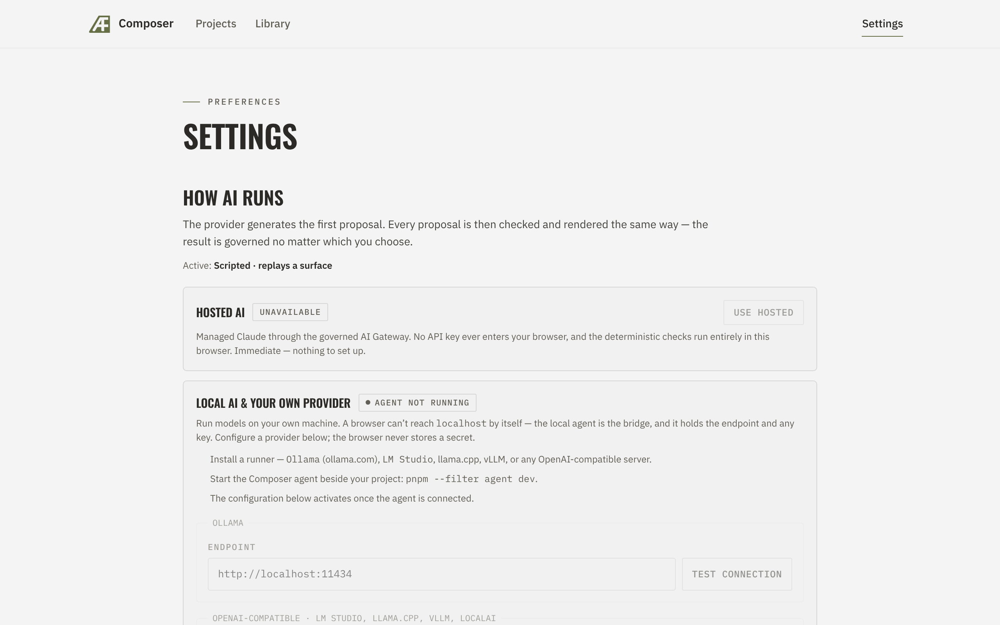
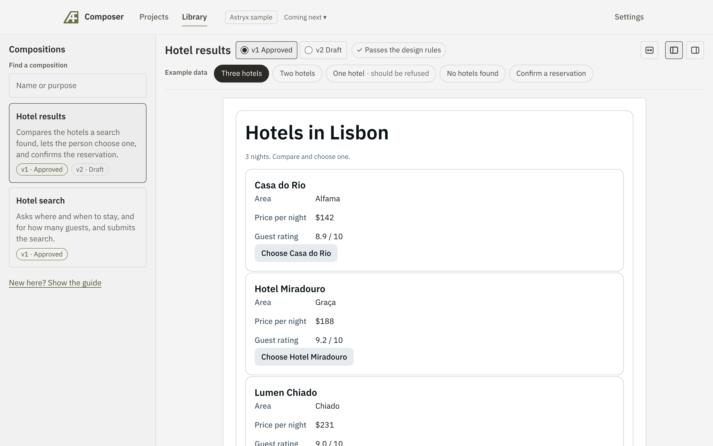
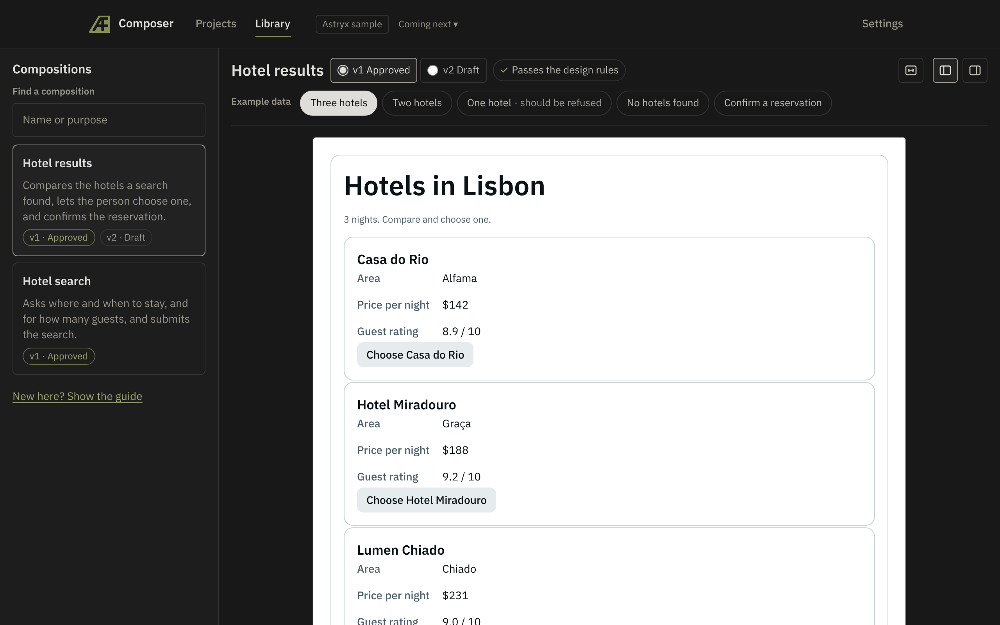
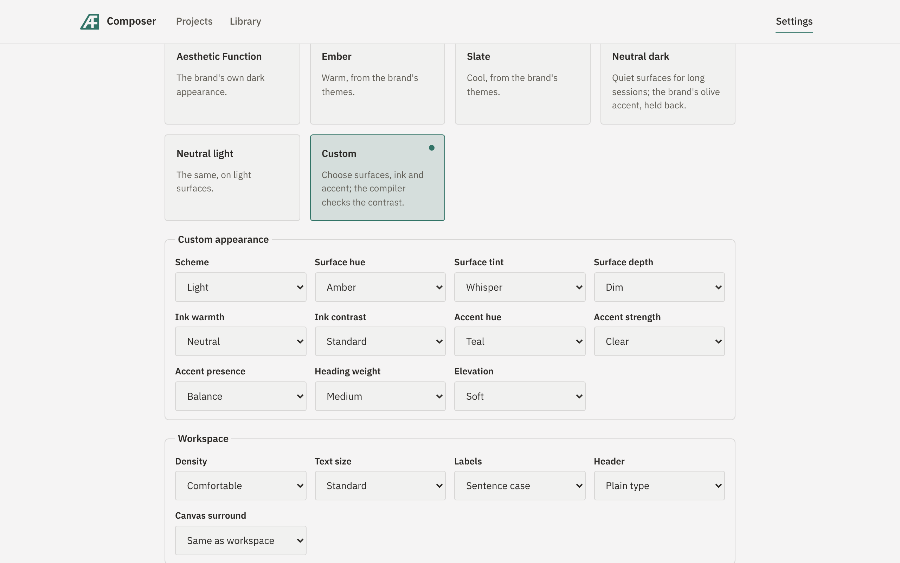
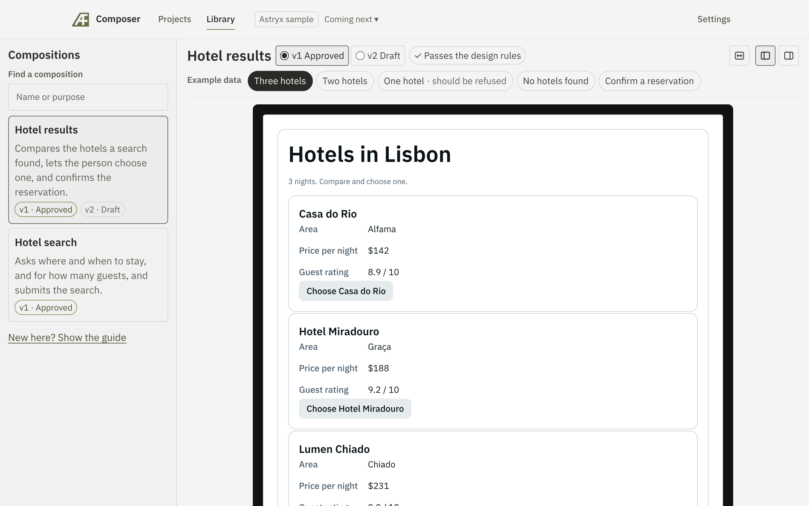
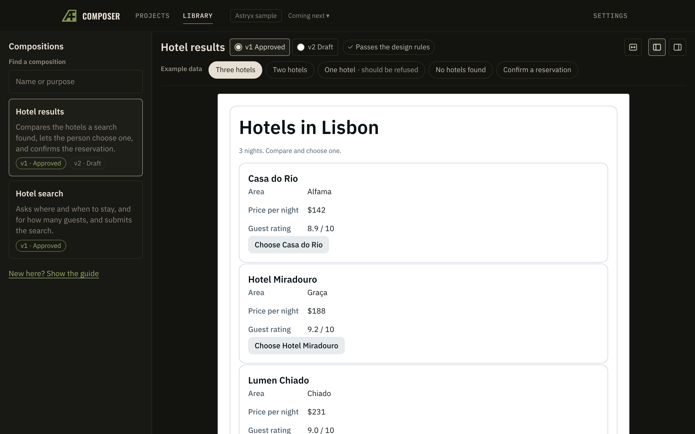

# M1 workspace appearance: the shared theme compiler in Composer (T1 to T4)

**Status:** accepted by the product owner, 2026-11-27 (decisions 41 to 44), and released: the compiler is published as `@aestheticfunction/dspack-gen` 0.6.0, and af-site and Composer pin that exact version. **Experimental build only**; the default application is unchanged. Human visual and usability acceptance is still outstanding.

A designer can now choose how Composer's workspace looks:
- the three existing appearances, **Aesthetic Function**, **Ember** and **Slate**, unchanged;
- **Neutral dark** and **Neutral light**: quiet surfaces, neutral ink, the brand's olive accent held back, and a plain header;
- **Custom**: surfaces, ink, accent, heading weight and elevation, chosen from the compiler's own vocabulary.

Every appearance also takes five **workspace choices**: density, text size, label case, header type and canvas surround.

None of this reaches the canvas. The design system draws the canvas exactly as before, under every appearance and every choice, and a test holds that.

## How it is built

| Step | Repository | What |
|---|---|---|
| **T1** | `dspack-gen` (public, Apache-2.0) | The deterministic theme compiler graduates from its incubation in Aesthetic Function's website as `@aestheticfunction/dspack-gen/theme` (0.6.0, published from tag `v0.6.0` with npm provenance). The compiler, its schema, constraints and solver move byte-identical. A workspace layer, `compileWorkspace`, adds status and link colours (solved to 4.5:1 on every surface) and the five workspace choices, without changing any compiler token. Its identity is `workspace-appearance@1.0.0` |
| **T2** | Aesthetic Function's website (private) | The website consumes the package instead of its own copy, with equivalent output: every compile golden regenerates byte-identically, and its browser runtime embeds the same compiler. A gate holds the pin exact and forbids a second copy |
| **T3** | `dspack-studio` | Composer pins the same published package, `npm:@aestheticfunction/dspack-gen@0.6.0`, as `dspack-gen-theme`; its governance dependency on `@aestheticfunction/dspack-gen` stays on 0.5.0. It is imported only by the experimental workspace, behind the experimental guard; the default artifact check refuses the compiler's markers |
| **T4** | `dspack-studio` | Settings, Appearance in the experimental build. This record |

There is **one compiler**. Composer has no theme generator, solver or palette of its own: a stored appearance is a proposal, compiled at load.

## What a designer can do

| In the interface | Underneath |
|---|---|
| **Settings, Appearance**: six cards. The chosen one is marked and pressed | `BASES` |
| Choose **Aesthetic Function**, **Ember** or **Slate** | The existing governed theme through `applyTheme`, so the default build's preference (`composer.appearance.v1`) stays in step. Only the workspace choices are added |
| Choose **Neutral dark**, **Neutral light** or **Custom** | A theme-direction v1 proposal compiled by `compileWorkspace` for one scheme. Composer's chrome variables are set from its tokens on the root element, under `data-theme="workspace"` |
| **Custom**: eleven menus (scheme, surface hue, tint and depth, ink warmth and contrast, accent hue, strength and presence, heading weight, elevation) | Each menu's options are the schema's own enum members; a unit test holds them equal |
| **Workspace**: density, text size, labels, header, canvas surround | Closed enums from the package (`WORKSPACE_OPTIONS`). The Library's font sizes scale with `--cl-type` and its plain paddings, gaps and margins with `--cl-space`; both are 1 by default, so nothing moves unless chosen. Minimum target heights are never scaled |
| A status line under the choices: **Applied. 34 contrast checks pass.** | The constraint and repair counts from the compiler |
| A choice that does not compile | **Not applied:** the first reason, and **The previous appearance stays.** Nothing is written |

## Guarantees and how they are held

| Guarantee | Held by |
|---|---|
| The canvas's computed styles do not change: colour, background, type, borders, radius, shadow, spacing and colour scheme of the frame and every element in it, under all six appearances and the workspace choices | `e2e/composer-appearance.spec.ts`, isolation. It found one leak while being written: **Large** text reached the canvas frame through inheritance (14 → 15.75 px). The frame now sets its own size and resets the workspace variables |
| The colour scheme Astryx and shadcn/ui surfaces inherit does not change | Same test: the root's computed `color-scheme` is identical under every appearance, and the frame keeps `color-scheme: light`. Nothing in the appearance code sets `color-scheme`; a unit test refuses any such variable |
| No draft, version, approval, check record or definition hash changes | Same spec: every storage record except the two appearance keys is byte-identical before and after five appearance changes, and the checks state is unchanged |
| A stored appearance is a choice, never values | The `appearance` record (v1) is validated field by field against the closed enums with exact keys; a colour, a variable or an unknown field is refused before writing, and refused again on load |
| A malformed, tampered or newer record is not applied | Browser test: three bad records each leave the default appearance |
| The text reads | The compiler's constraint set (C1 to C18b) and the workspace checks (W1 to W15): body, dim and accent text and every status colour at 4.5:1 or better on every surface. Unit test over every surface and accent hue in both schemes. axe (WCAG 2.2 AA) on Settings and the Library under Neutral light and Neutral dark at 1280 and 390 px, with **no exceptions** |
| D0.1's floors hold under compact density | Browser test: no workspace text under 12 px and no control under 24 px |
| The default build is unchanged | The compiler is reachable only through guarded dynamic imports; `check-default-artifact` refuses `theme-direction-compiler@`, `workspace-appearance@` and `composer-workspace-appearance` |

One shared stylesheet line changed, for every build: the active state of the settings buttons (`.st-btn--active`) drew a fixed dark ink on the accent. Under a light appearance that failed contrast (axe found it). It now uses `var(--on-accent, #10120c)`. The three governed themes define `--on-accent` as `#10120c`, so the default build computes exactly what it did. On every compiled appearance, the accent label reads at 4.88:1 or better on the fill and on its hover state, across all 7,203 custom directions tried.

## Screenshots

Experimental build, 1280 × 800, synthetic data.

| | |
|---|---|
|  |  |
| Settings under Neutral light | The Library under Neutral light: the canvas is the design system's own, unchanged |
|  |  |
| The Library under Neutral dark | Custom, with its menus |
|  |  |
| Neutral light, compact, large text, a dark canvas surround | The default Aesthetic Function appearance, for comparison |

## Not in this increment

- **Project export** of the appearance (deferred by the owner).
- **Natural-language theme generation.** The hosted front end that proposes a direction from a phrase stays in the website; no inference is added.
- **The production application.** The default build keeps its three governed themes and its Settings.
- **Approval withdrawal** is recorded as a requirement (decision 34), not built.

## Run it

```bash
pnpm --filter composer build:experimental
```

```bash
pnpm exec playwright test --config playwright.composer-experimental.config.ts e2e/composer-appearance.spec.ts --trace off
```
