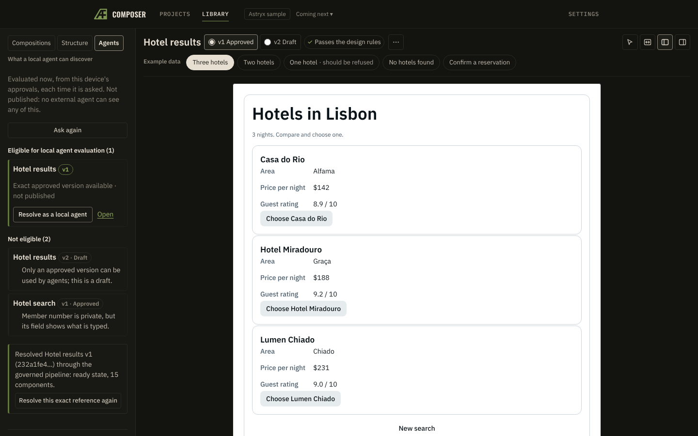
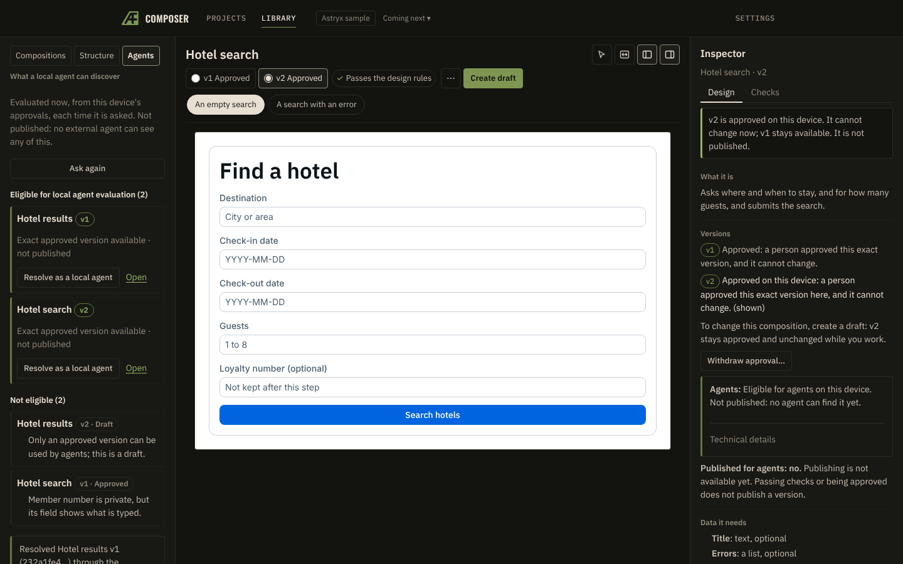
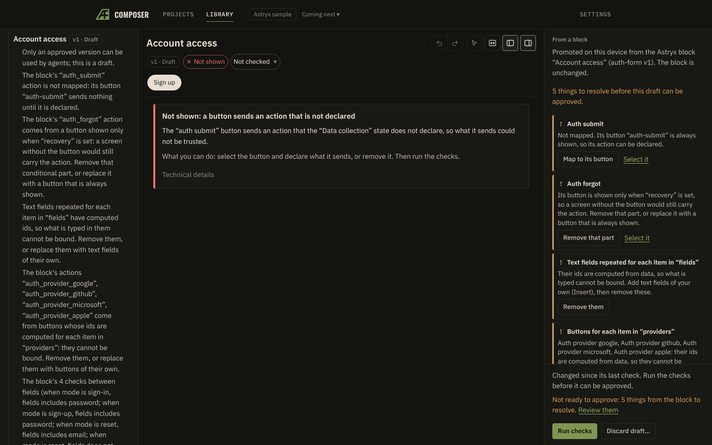
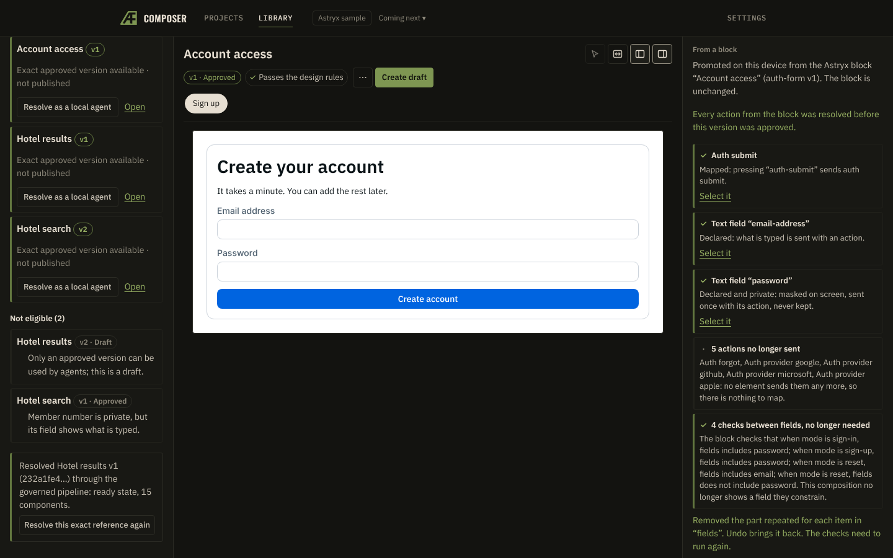
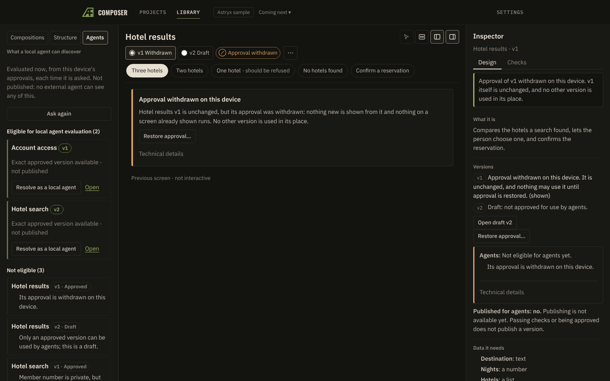
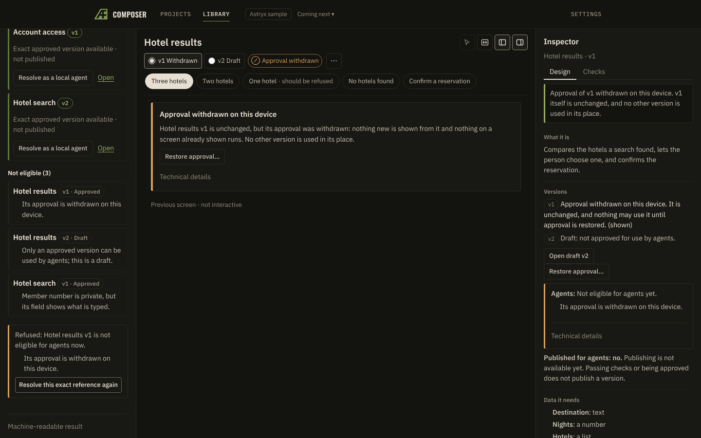
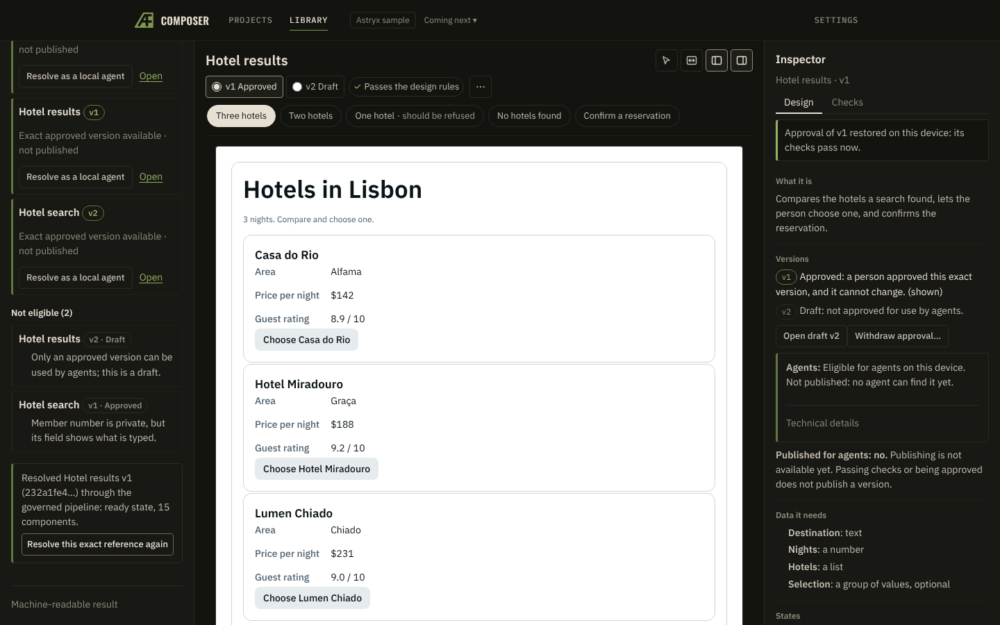

# M1 local agent-facing discovery (decisions 88 to 90)

**Status:** implemented for the product owner's evaluation, 2026-11-28. **Not merged or deployed.** Experimental build only. Local and synthetic: there is no endpoint, nothing is published, and no hosted model is used.

A simulated agent on this device can ask which compositions it may use, and can resolve an exact version through the governed pipeline. The designer sees the same answer in the Library's **Agents** view.

## The mechanism

`apps/composer/experimental/workspace/discovery.ts`:

| Call | What it does |
|---|---|
| `discover(ctx, { examples? })` | Reads the authorization authority **at this call**. Evaluates every version with `agentEligibility`, the one gate (decision 85), and returns the eligible exact versions plus every other version with its reasons. Examples (synthetic data) are included only when asked |
| `resolve(ctx, reference, { data, state? })` | Takes `{ composition, version, definitionSha256 }`. Refuses an unknown version (no other version is substituted) and a hash that no longer matches (`altered`). Re-evaluates eligibility now (`ineligible`, with reasons). Otherwise renders through a fresh host and the governed pipeline (`createHost`, `show`): a design-rule refusal is `refused` |
| `simulatedAgent(ctx, want?)` | Deterministic: discovers with examples, picks a composition, resolves it with its first example. No model |

The answer is the `composer.local-discovery/1` document. Each eligible entry carries:
- `reference`: id, exact version, definition hash;
- `title`, `purpose`;
- `compatibility`: composition document version and the contract, profile, toolchain and interaction pins;
- `data`: declarations only;
- `inputs`: name, kind, required, private;
- `actions`: name, the states it is sent from, the payload keys it sends (never values), the inputs it carries, whether it is consequential, intended next states;
- `states`: id, title, description, purpose, and when it is shown.

Never included: private input values, payload values, diagnostics, authoring records, drafts.

## Representative machine-readable result

The packaged library on a fresh device, produced by `discover()` (the data declarations are shortened). The definition hashes are the historical ones, and the contract digest is unchanged (`4c6ce46…`).

```json
{
  "schema": "composer.local-discovery/1",
  "scope": "local-synthetic",
  "published": false,
  "authorizationGeneration": 0,
  "eligible": [
    {
      "reference": {
        "composition": "hotel-results",
        "version": 1,
        "definitionSha256": "232a1fe4fced886cf199eef6fca846cde693cda5071be0b8737e39dfbe0ed913"
      },
      "title": "Hotel results",
      "purpose": "Compares the hotels a search found, lets the person choose one, and confirms the reservation.",
      "compatibility": {
        "compositionsSidecar": "0.2",
        "contractSha256": "4c6ce46dcdb23854a191a4f783166ee6c188a402b74f4ecbf9755d29c09c1889",
        "profileSha256": "221426c9c90d2319fc90735668077137f0548f04403c5d0105a85093f7e078e9",
        "toolchainSha256": "84416287781c9c5badf6bd96d792aea8d9ef2115f0f7b36deee4ff14d7e2ed30",
        "interactionSha256": "def08ab6d03024de8b54693bfab6cc24f11a524c246dd6a9171b1e28258403b0"
      },
      "data": [
        {
          "name": "destination",
          "type": "string",
          "required": true
        },
        {
          "name": "nights",
          "type": "integer",
          "required": true
        },
        {
          "name": "hotels",
          "type": "array",
          "required": true
        },
        …
      ],
      "inputs": [
        {
          "name": "destination",
          "kind": "text",
          "required": true,
          "private": false
        }
      ],
      "actions": [
        {
          "name": "choose",
          "sentFrom": [
            "ready"
          ],
          "sends": [
            "hotelId"
          ],
          "carriesInputs": [],
          "consequential": false,
          "intendedNext": []
        },
        {
          "name": "new_search",
          "sentFrom": [
            "ready"
          ],
          "sends": [],
          "carriesInputs": [],
          "consequential": false,
          "intendedNext": []
        },
        {
          "name": "search_again",
          "sentFrom": [
            "empty"
          ],
          "sends": [],
          "carriesInputs": [
            "destination"
          ],
          "consequential": false,
          "intendedNext": []
        },
        {
          "name": "reserve",
          "sentFrom": [
            "confirm"
          ],
          "sends": [
            "hotelId"
          ],
          "carriesInputs": [],
          "consequential": true,
          "intendedNext": []
        },
        {
          "name": "back",
          "sentFrom": [
            "confirm"
          ],
          "sends": [],
          "carriesInputs": [],
          "consequential": false,
          "intendedNext": []
        }
      ],
      "states": [
        {
          "id": "confirm",
          "purpose": "destructive-action",
          "shownWhen": "'selection' is present"
        },
        {
          "id": "empty",
          "purpose": "data-collection",
          "shownWhen": "'hotels' is empty"
        },
        {
          "id": "ready",
          "purpose": "transactional-review",
          "shownWhen": "always"
        }
      ]
    }
  ],
  "excluded": [
    {
      "reference": {
        "composition": "hotel-results",
        "version": 2,
        "definitionSha256": "29fef68ba0a29981731caf765be49babef5c31433c6cbd16c5f9005c0270038c"
      },
      "title": "Hotel results",
      "status": "draft",
      "reasons": [
        {
          "kind": "status",
          "text": "Only an approved version can be used by agents; this is a draft."
        }
      ]
    },
    {
      "reference": {
        "composition": "hotel-search",
        "version": 1,
        "definitionSha256": "856b491b237bb451b422ff33d04af2cdd04b71f9de08b4f16b27ecd3c130e4f8"
      },
      "title": "Hotel search",
      "status": "approved",
      "reasons": [
        {
          "kind": "safety",
          "text": "Member number is private, but its field shows what is typed."
        }
      ]
    }
  ]
}
```

## The eight demonstrations

Each one is asserted by `e2e/composer-discovery.spec.ts`, which also writes these screenshots (`DISCOVERY_SHOTS=1`).

| | |
|---|---|
|  |  |
| 1. Hotel results v1 is eligible; its exact reference resolves through the governed pipeline | 2. Hotel search v1 is excluded: it needs a safety update |
|  |  |
| 3. A corrected Hotel search v2 (private field masked, checked, approved) is discoverable; v1 stays excluded | 4. A promoted, unresolved Account access is excluded with what is unresolved |
|  |  |
| 5. Resolved and approved, it is discoverable; its password field is described as private | 6. Withdrawing Hotel results v1 removes exactly that version |
|  |  |
| 7. The reference obtained in step 1 is refused, with the reason | 8. Restoring runs the checks now; the same reference resolves again |

A second browser test withdraws Hotel results in one tab while another tab shows discovery. The other tab's next request excludes it: discovery reads the authority, not what that tab last showed.

## Designer experience

The **Agents** view sits beside Compositions and Structure. It shows:
- **Eligible for local agent evaluation**: each exact approved version, with "Exact approved version available · not published", and **Resolve as a local agent**.
- **Not eligible**: each other version, with its reasons in words.
- The last resolution, in words, with **Resolve this exact reference again**.
- **Machine-readable result**, behind a disclosure.

There is no separate governance dashboard: the inspector's existing **Agents:** line answers the same question for one version.

## Evidence

- Unit (`discovery.test.ts`, 8):
  - inclusion and exclusion;
  - the minimum exposed, with no values and examples only on request;
  - private fields described as private;
  - request-time evaluation, withdrawal after discovery, a refused old reference and restoration;
  - exact resolution (an altered hash or unknown version is refused, a draft is never resolved);
  - the governed pipeline refusing rule-breaking data;
  - promotion excluded, then included;
  - intended transitions exposed; the simulated agent.
- Browser (`composer-discovery.spec.ts`, 4): the eight demonstrations; cross-tab request-time evaluation; axe at 1440 and 390 px with keyboard operation and no horizontal overflow.

## Limitations

- **Local only:** an agent in this page, reading this browser's authority. No other device, browser or agent can discover anything, and nothing is published.
- **Eligibility is evaluated here** against this tab's hosts and checks. The server-side boundary is proposed in [SERVER-AUTHORIZATION-PROPOSAL.md](SERVER-AUTHORIZATION-PROPOSAL.md) and not implemented.
- **Resolution renders and governs a surface; it does not run actions.** Real action-to-state behaviour belongs to the Interactive Playground.
