# M1 advanced authoring: Structure, canvas selection and interaction authoring

**Status:** implemented for the product owner's evaluation, 2026-11-27. **Not merged or deployed.** Experimental build only; the default application and artifact are unchanged.

The workspace moves from editing a draft's details and examples to **authoring what its elements do**. A designer can:
- select any element of a composition, on the canvas or in a Structure tree;
- see what it shows and where that comes from;
- declare and edit what a person types into it;
- declare and edit what pressing it sends;
- try the result on the canvas;
- run checks and approve the version on this device.

It extends the existing workspace and the A1 to A4 lifecycle. There is no new schema, editor, shell or governance pipeline:
- every change is an edit of the composition's own `inputs` and `actions`;
- each edit goes through `editDraft` and the packaged loader;
- previews go through `instantiate`, approval through `approveVersion`.

## What a designer can do

| In the interface | Underneath |
|---|---|
| **Structure** (left panel, beside Compositions) | `structureOf` (composer-core `structure.ts`): one state's template as a tree. A repeat is one node, **Each hotel**, and what it yields is listed once, with **×3** for the items on the canvas now. Arrow keys move through the tree and the canvas follows; Enter opens the inspector. A **State** menu lists the other states, whose elements can be inspected even when they are not on the canvas |
| **Select** (toolbar, Escape to leave) | A transparent layer beside the canvas turns a click into a selection. The canvas is inert meanwhile, so nothing is typed or pressed by accident. The selected element is outlined; when it repeats, every item is outlined and the picked one most strongly |
| **The inspector, contextual** | **What it shows**: each label and text, marked Fixed, From the data, Parameter, or Text and data. **What a person types** for a text field. **When pressed** (or **When confirmed**) for a button or dialog. **Technical details** stay in a closed disclosure. Actions and typed fields listed on the composition are links to their elements |
| **A repeated element** | "Repeated for each hotel in hotels (3 in this example). You picked the one for “Hotel Miradouro” (item 2 of 3). **Changes here apply to every hotel.**" What is edited is always the reusable definition. Which item was picked comes from the instance's own binding evidence, and is never stored |
| **What a person types** (draft) | Name, Kind (Text, Date, Whole number), Required, shortest and longest length, smallest and largest value, **Private (sensitive)**, and Stop taking typed input. Renaming follows into every action that sends the field. A field still sent by an action cannot be removed until it stops being sent |
| **When pressed** (draft) | **Trigger**, the action's name, and where it is shown. **What it sends**: each value comes from a declared field or is fixed; inside a repeat, only the item's own fields are offered. **Also sends what was typed in**: only fields shown wherever the action is sent from. **Tell the items apart by** (repeated). **Safeguards**. **Try it**: what the picked item would send |
| **Try it** | Turn Select off and press the element. The note shows exactly what it would send, with private values replaced. Nothing runs |
| **An invalid change** | Refused before it applies, in plain words, for example: “Another typed field is already called “destination”. Choose a different name.” Anything the loader still refuses is said plainly too. A change that only the checks can find fails those checks with the reason, for example items that cannot be told apart |
| **Checks and approval** | Any edit makes the draft's checks stale. Approval needs a current passing check (A3, A4) and, new here, **every private field masked on screen** |

## Guarantees and how they are held

| Guarantee | Held by |
|---|---|
| Identity is definition-level. An element is its literal template id (`#choose`) or its state and template path (`ready@2.0.0`). Never a rendered id: those carry per-item suffixes and layout wrappers | `structure.test.ts`: the same keys under every example; nothing about a selection is stored (browser spec) |
| A rendered component maps to its element only when the instance's own evidence agrees. The map is a structural walk of template, expansion and emitted components, cross-checked against every bound action's item index and every input's component; any disagreement, or a condition it cannot follow, gives no map | `structure.test.ts`: reordered, removed and twenty-item examples; a tampered expansion, a lying item index and a condition all give no map |
| Item k's action sends item k's values | The binding walk (`bindings.ts`, unchanged); `structure.test.ts` and `interaction.test.ts` through the real pipeline; the browser spec presses Choose on two hotels |
| Only compatible bindings. A typed field is a text field outside any repeat. An action belongs to a button or dialog with a template id and is named as the emitter names it. A payload reads declared fields only, inside a repeat the item's own. Carried fields are shown wherever the action is sent from | `roleOf`, `inputProblem`, `actionProblem`, and the loader. New core rules: one input per name and per node, one action per name and per node, and an action named by its node |
| Safeguards are never relaxed. A confirmation stays one, and the editor cannot turn consequential off. A consequential action sends fixed values only. A repeated action never carries typed fields. Stale-action refusal, once-per-surface and idempotency are the host's, unchanged | `interaction.test.ts`; the browser spec on Reserve |
| Private means masked. Marking a field private sets the contract's own `type: "password"` on that field in every state, so it renders obscured. It is still sent once, never prefilled, and replaced in anything recorded | `interaction.test.ts` (obscured emission, empty initial value); browser spec (password input; the typed value appears in no note and no stored record) |
| Approved versions never change | `editDraft` refuses them; tests compare packaged v1 byte for byte |
| The canvas is not restyled by selecting | The layer sits beside the frame. Browser spec: every computed style in the canvas is identical with and without a selection. The appearance spec's isolation tests still pass |
| The default build carries none of it | `check-default-artifact` refuses `structure-panel`, `element-inspector` and `select-layer`: 29 files clean of 28 markers |

## The packaged Hotel search v1 and its private field

Hotel search v1 marks the loyalty number private, but its field is not masked. v1 is approved and immutable, so it stays as it is, and the inspector says so for that field. A draft made from it inherits the gap. The authoring bar then says “Member number is private, but its field shows what is typed. Mask it before this version can be approved.”, and **Mask the field** fixes it in one step. The packaged compositions, their goldens and the contracts are unchanged.

## Not available, by decision or by the architecture

- **Layout editing.** Adding, removing, moving or re-nesting elements; changing what an element shows (labels, text); giving an element an id. That is template editing, the next increment. An element without a template id cannot take a binding until then, and the inspector says so.
- **A starting value for a typed field.** The definition format has none: a field holds what the person types, or what a replacement carries over. A private value must start empty. Adding a field for it would be a schema change, so it is reported rather than invented.
- **Removing an action from a button.** Every dispatching component must be declared, so the editor never leaves a button undeclared.
- **Nested repeats and conditions.** Repeats inside repeats are not supported by the bindings. A template with a condition (`$if`) shows in Structure but cannot be selected on the canvas.
- **Keyboard selection on the canvas.** Select mode is pointer-only by design; Structure is the keyboard path to every element.
- Still deferred:
  - block promotion;
  - agent-facing discovery;
  - approval withdrawal (decision 43);
  - side-by-side comparison;
  - mobile split preview;
  - the Playground;
  - external execution and publication;
  - protocol tracks.

## Evaluate it

From a clone of dspack-studio:

```bash
pnpm install && pnpm --filter composer build:experimental
```

```bash
COMPOSER_OUT_DIR=out-experimental PORT=3315 node e2e/serve-composer.mjs
```

Open http://localhost:3315, then **Library**. A suggested walk, about ten minutes:

1. **Hotel search → Create draft.** Press **Select** (the arrow in the toolbar) and click the **Check-in date** field.
2. In **What a person types**, rename it `destination`. It is refused and says why. Rename it `arrival`.
3. Click **Search hotels**: it already sends `arrival`. Click the **Loyalty number** field: it is private but not masked. **Run checks**; the bar asks you to mask it. Choose **Mask the field**.
4. Press Escape to leave Select. Type into the fields and press **Search hotels**: the note shows what would be sent, and the loyalty number as “private: not shown, never kept”.
5. **Hotel results → v2 Draft.** With Select on, click the third hotel's **Choose** button. The inspector says which hotel you picked and that changes apply to every hotel.
6. **Add a value** named `hotelName` from **Hotel name**. Leave Select and press Choose on two hotels: each sends its own name.
7. Choose the **Confirm a reservation** example and select **Reserve**. The confirmation is locked on, and it sends fixed values only.
8. Open **Structure**: move with the arrow keys and watch the canvas follow. Change the example to **No hotels found** and see what the inspector says about the selected button.
9. Back on **Hotel search v2**: **Run checks**, then **Approve version…**. Select a field again: the approved version is read-only.

To start again, clear the site's data for localhost in the browser.

## Screenshots

Experimental build, 1440 × 900 unless noted, synthetic data.

| | |
|---|---|
| 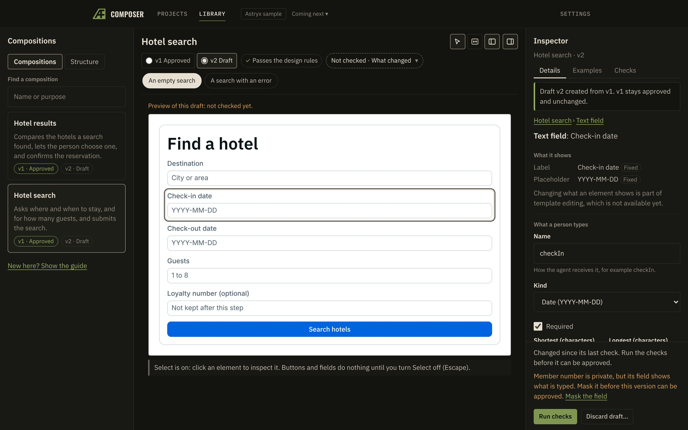 | 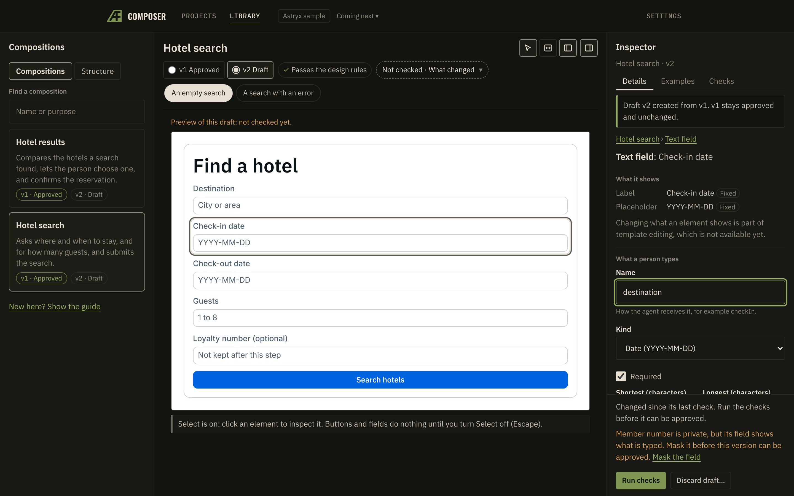 |
| 1. A field selected on the canvas; what a person types | 2. A duplicate name refused in plain words |
|  | 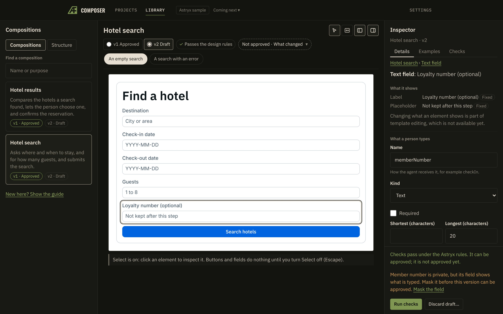 |
| 3. Search sends the renamed field | 4. The private field must be masked before approval |
| 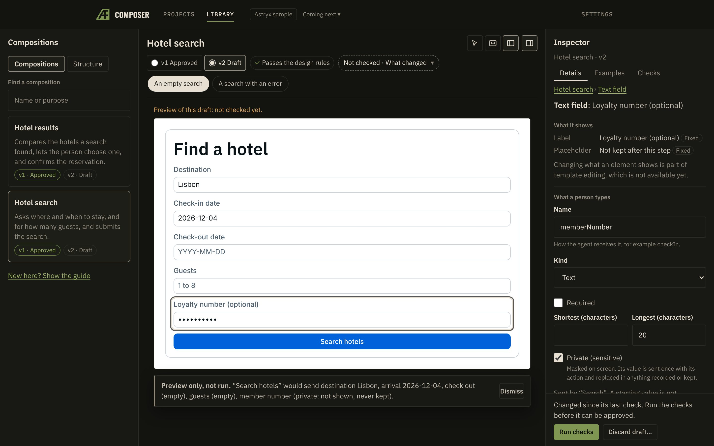 | 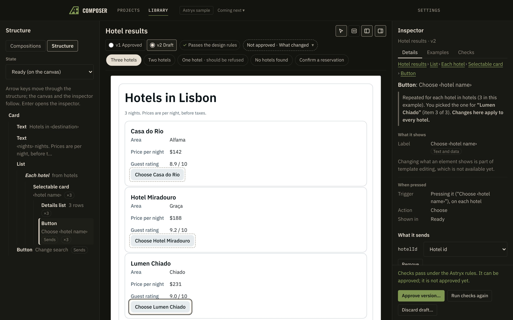 |
| 5. Preview: masked on screen, not shown in the note | 6. Structure, and one hotel's Choose picked in the repeat |
| 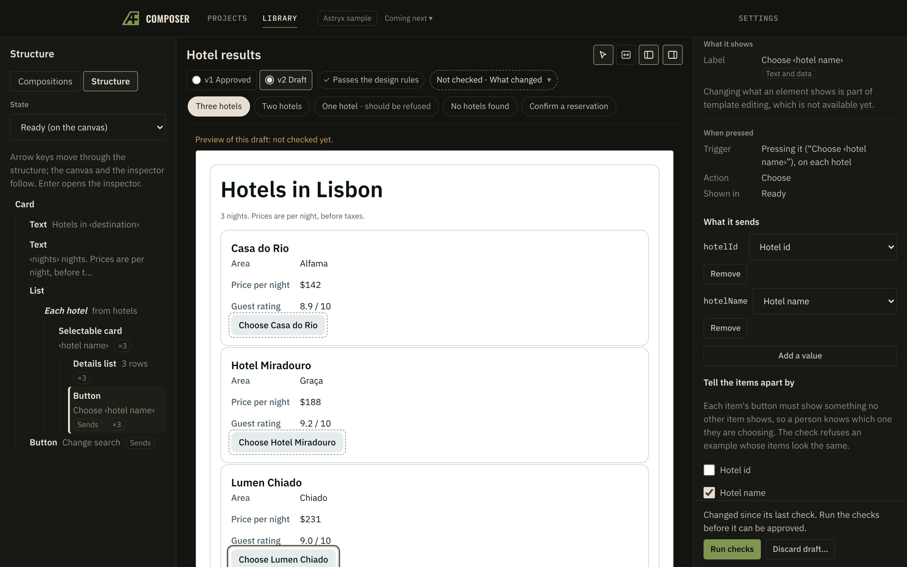 | 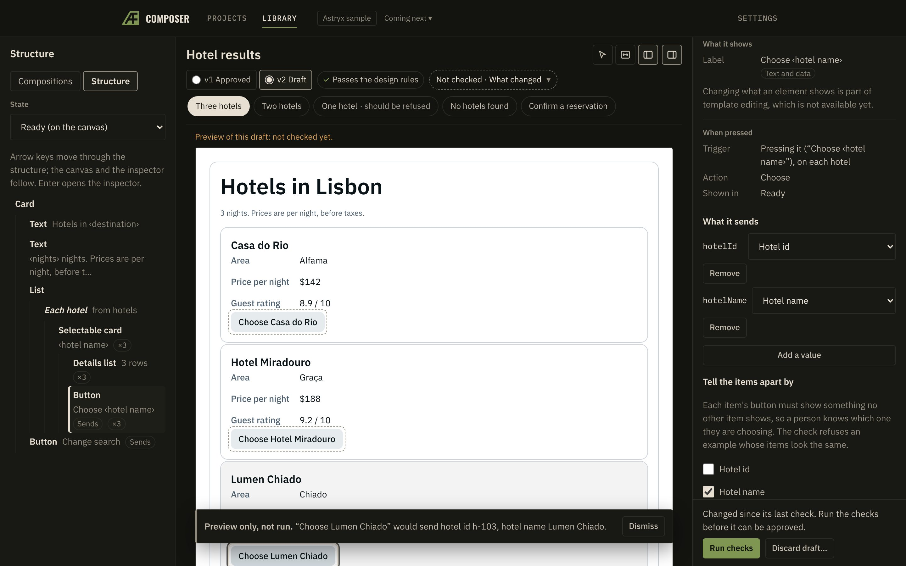 |
| 7. What each hotel's Choose sends, edited | 8. Preview: the picked hotel sends its own values |
| 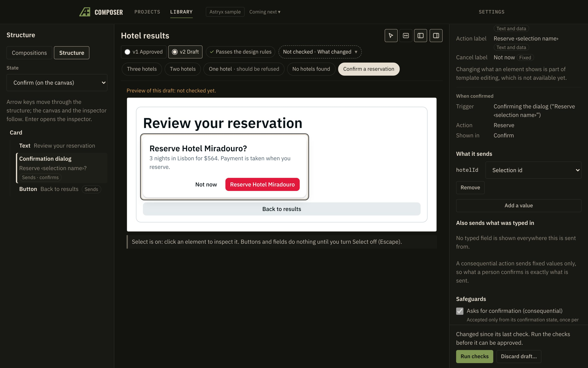 | 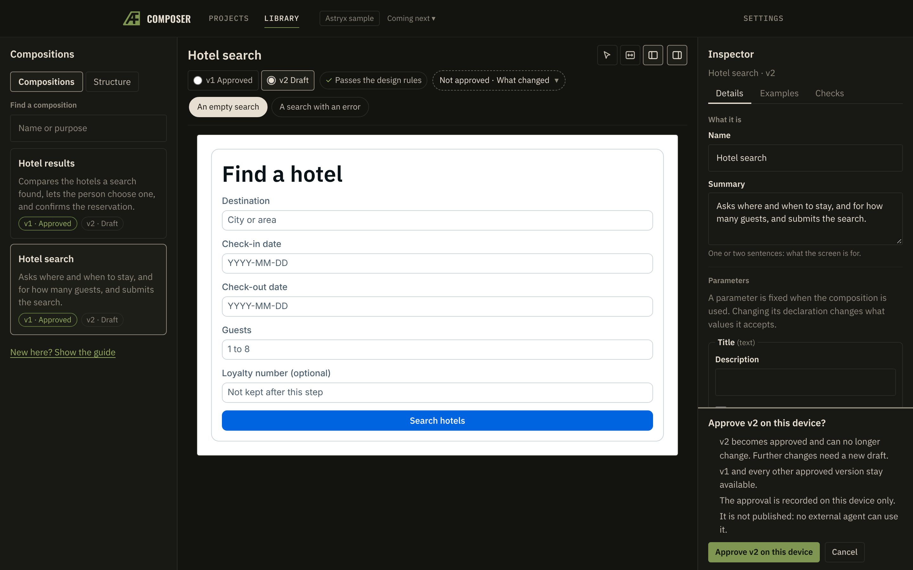 |
| 9. The confirmation's safeguards, locked | 10. Approve on this device |
| 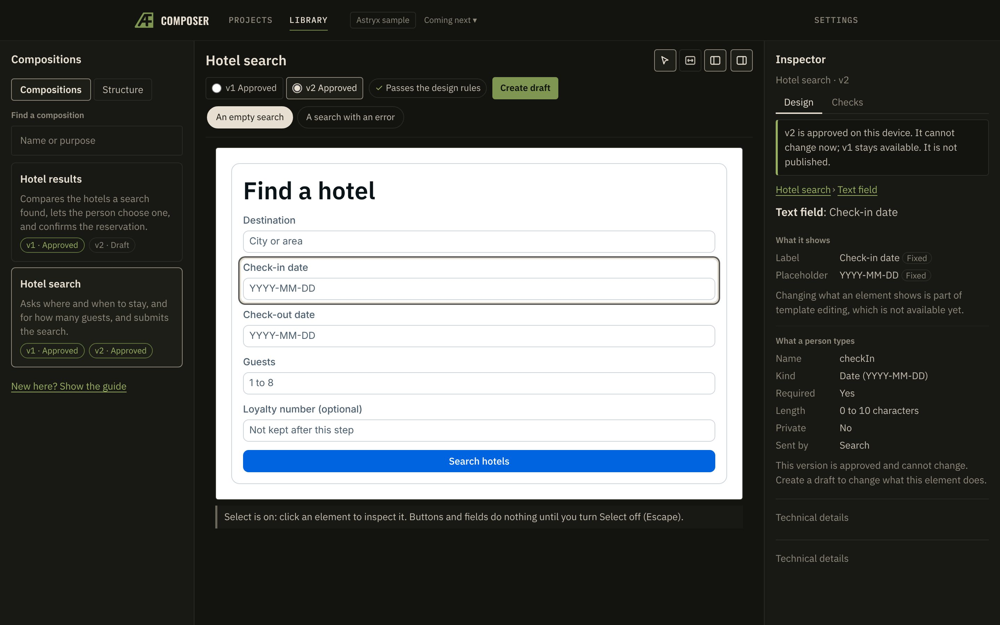 | 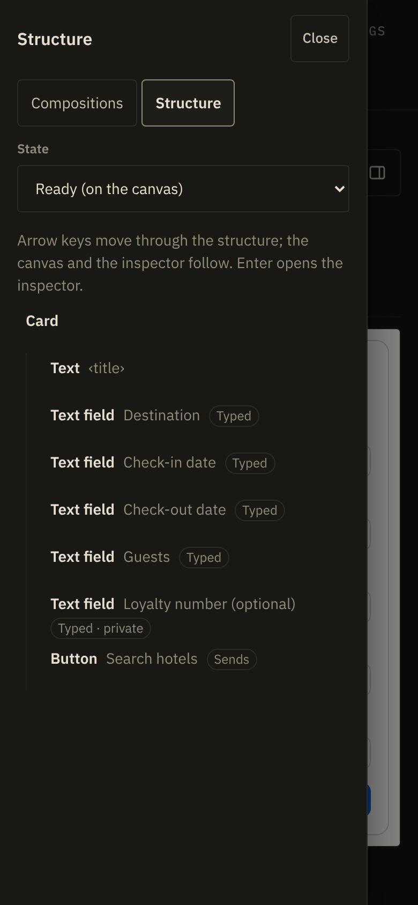 |
| 11. The approved version is read-only | 12. Structure on a phone (390 px) |
