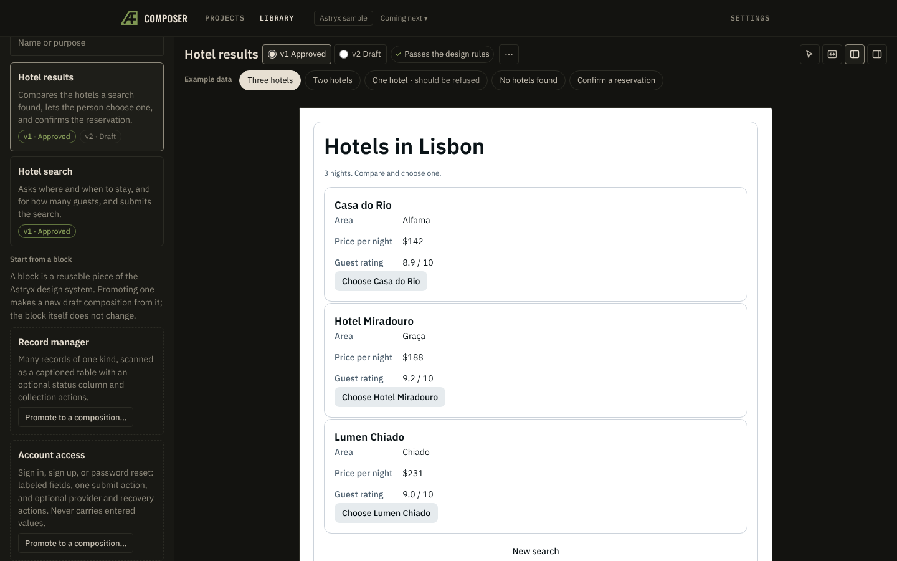
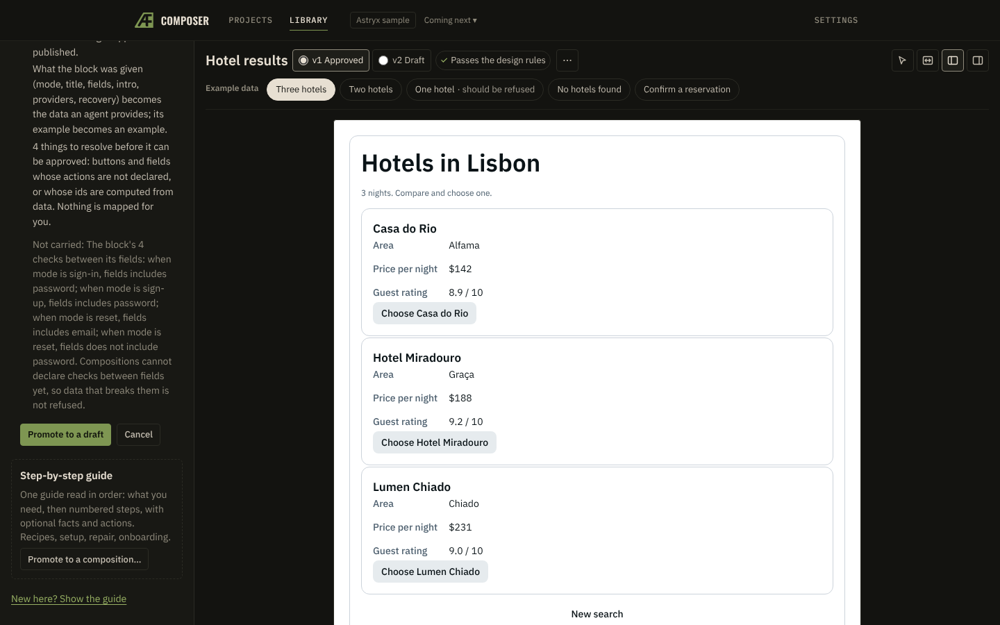
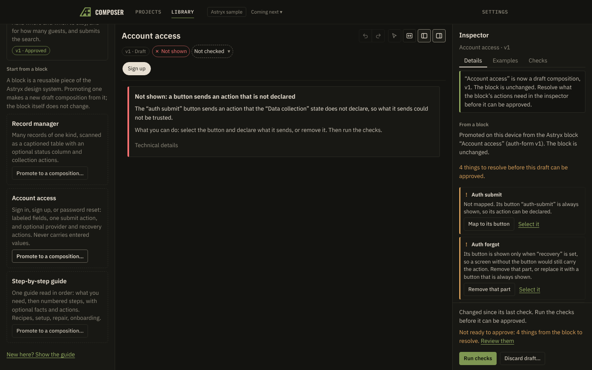
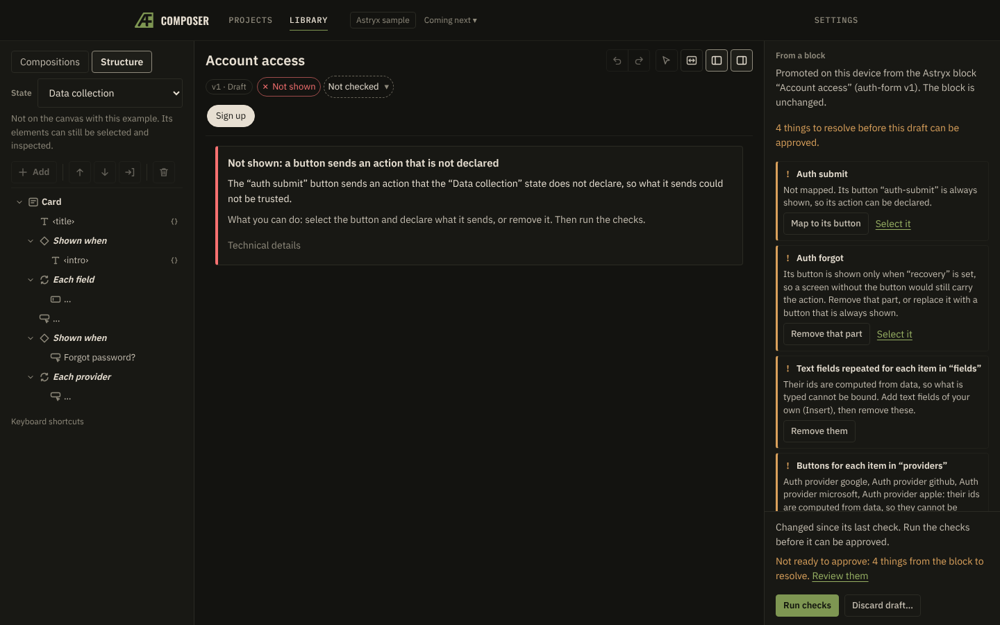
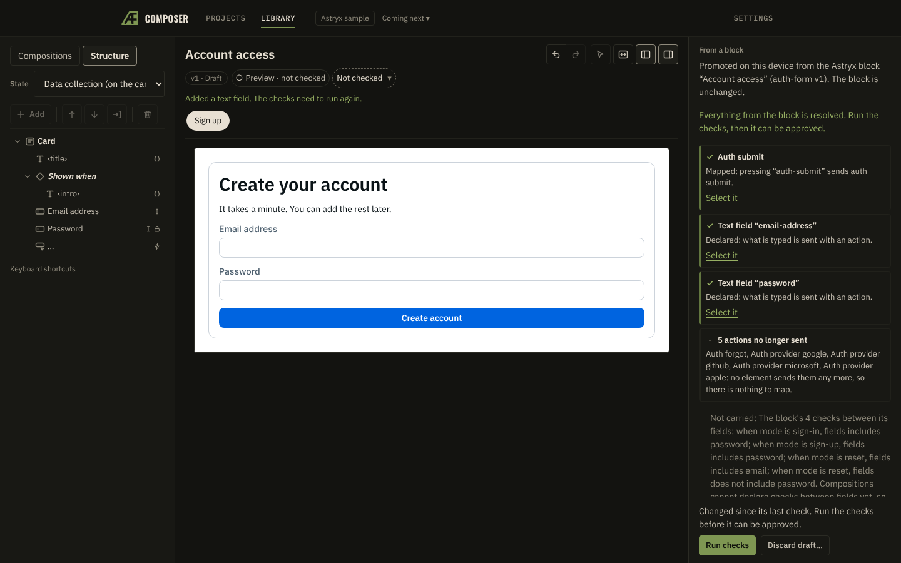
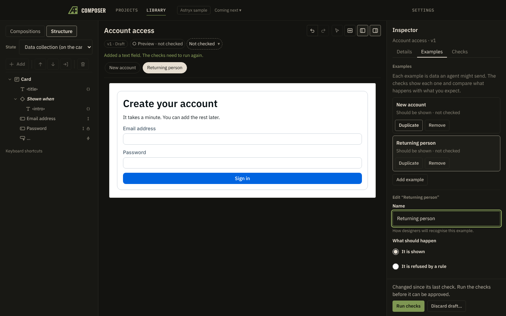
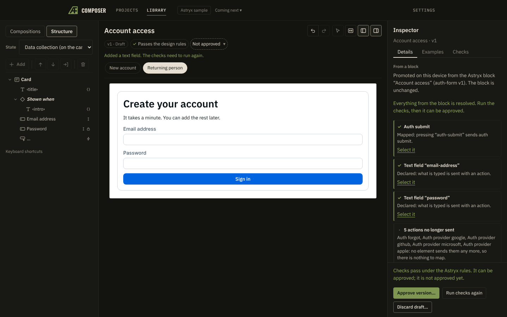
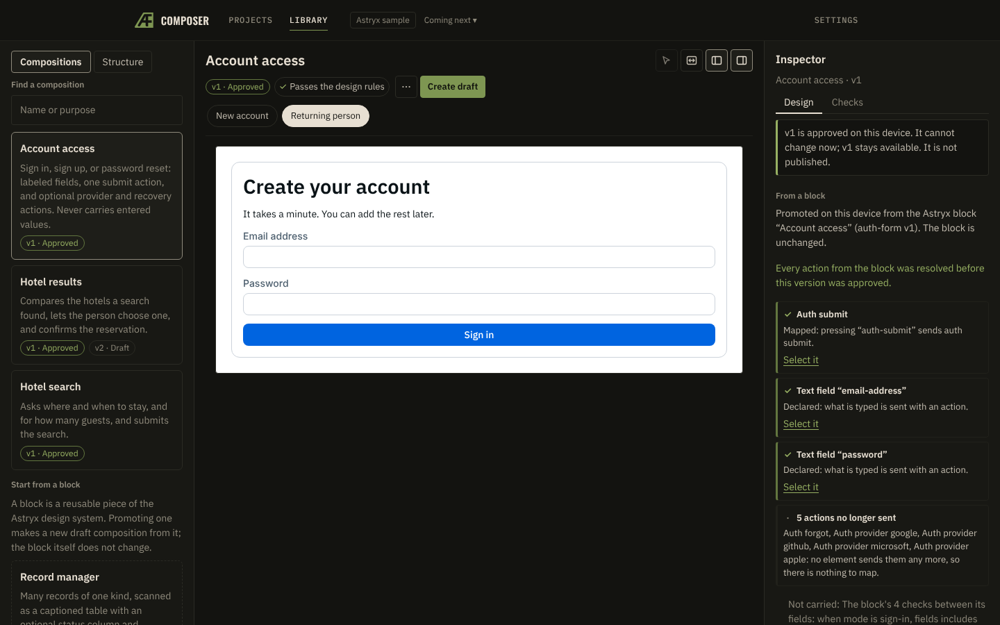
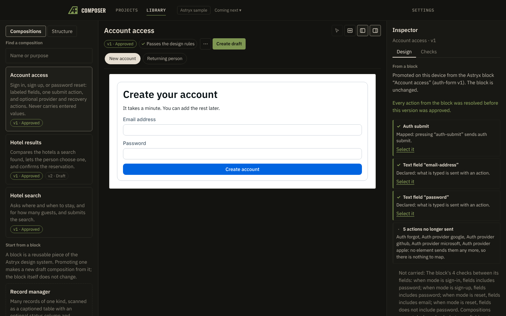

# M1 block promotion (slice D)

**Status:** implemented for the product owner's evaluation, 2026-11-28. **Not merged or deployed.** Experimental build only; the default application is unchanged.

A designer can start a new composition from a packaged Astryx block. The result is a new **draft** composition. It goes through the same loader, editing, checks and approval as every other draft. The block itself never changes. Nothing is mapped for the designer, and approval stays blocked until every interaction the block had is resolved or explicitly removed.

## What a promotion makes

| | From the block | In the new draft |
|---|---|---|
| **Identity** | `auth-form` v1 | A new composition id: the block's id, or the next free one (`auth-form-2`). Version 1, status draft |
| **Structure** | The block's template | One state, for the block's first intent, always shown. The template is the block's own, unchanged |
| **Data** | The block's props | The composition's `data`, with the same declarations. An agent provides them and they are validated the same way |
| **Examples** | `examples[].call` | One example per block example, expected to be shown, with a readable title |
| **Actions** | Names the emitter writes for buttons | **None declared.** Each one is reported (below) |
| **Provenance** | | A device record, `promotions` v1: composition, block, block version, reference. It never changes the composition or the block |

The 0.2 composition schema is unchanged. Provenance is kept beside the composition, not in it, because the strict 0.2 parser accepts no extra field. That limitation is recorded, not worked around.

## What is reported, and how each kind is resolved

| Kind | Example in auth-form | Resolved by |
|---|---|---|
| **Mappable:** a button with a literal id, always shown | Submit (`auth-submit`) | **Map to its button**: declares its action through the ordinary action authoring |
| **Conditional:** a literal button shown only when a field is set | Forgot (`$if recovery`) | **Remove that part**, or replace it with a button that is always shown. A screen without the button would still carry the action |
| **Computed actions:** button ids built from data inside a repeat | One provider button per item in `providers` | **Remove them**, or add buttons of their own. Computed ids cannot be bound |
| **Computed text fields:** field ids built from data | One field per item in `fields` | Add text fields of their own (**Add**, Text field), then **Remove them** |
| **No longer sent:** no element emits it any more | After a removal | Nothing to map; listed once, as information |
| **Not carried:** what a 0.2 composition cannot declare | auth-form's 4 checks between fields; records-table's equal-length check; further intents | Said in the confirmation and in the inspector. Never dropped silently |

Every resolution is an ordinary, undoable draft edit, checked by the same loader. **Approval is refused** while anything is unresolved (`approveVersion`, through `promotionBlockers`), even when the checks pass. If the block it came from cannot be found, approval stays blocked rather than passing unchecked.

## Walkthrough: Account access (auth-form)

Each step is asserted by `e2e/composer-promotion.spec.ts`, which also writes these screenshots (`PROMOTION_SHOTS=1`).

| Step | What happens | Screenshot |
|---|---|---|
| 1. Open the block | Compositions panel, **Start from a block**: Record manager, Account access, Step-by-step guide |  |
| 2. Promote | **Promote to a composition…** says what it will make, that nothing is approved or published, the 4 things to resolve, and what is not carried. **Promote to a draft** |  |
| 3. Inspect | The draft appears in the list (v1 · Draft). The inspector opens on **From a block**: where it came from, and each interaction with its status. The canvas refuses it in plain words: a button sends an action that is not declared |  |
| 3b. Structure | The block's template, unchanged, in Structure |  |
| 4. Resolve the mapping | **Map to its button** on Submit: resolved | |
| 5. Identify what is unsupported | **Remove that part** on Forgot; **Remove them** on the provider buttons. Add **Email address** and **Password** text fields before Submit, tick Password **Private**, then **Remove them** on the computed fields. Everything is resolved; the field checks stay listed as not carried |  |
| 6. Refine the examples | Rename the example **New account**; duplicate it as **Returning person** with mode sign-in |  |
| 7. Preview and check | The form renders through the governed pipeline; **Run checks** passes |  |
| 8. Approve | **Approve version…**, confirm: v1 Approved on this device. Not published |  |
| 9. Reopen | After a reload, choose Account access in the Library: approved, with where it came from and how it was resolved |  |

## How it is built

- **Core (`packages/composer-core/src/compositions/promotion.ts`):** `promoteBlock` starts from `upcastBlock` (unchanged) and works on a copy. `promotionMappings` classifies each interaction; `promotionIssues` is what blocks approval; `promotionPartKey` finds the repeat or condition to remove. `template.ts` now lets a whole conditional part be removed (it refused that before), which is how a conditional button is removed with its condition.
- **Workspace:**
  - `promotableBlocks` loads the packaged Astryx blocks through the blocks loader, against the same contract as the compositions.
  - `promoteBlockDraft` validates the new draft with `definitionIssues`, then writes provenance before the draft.
  - `approveVersion` checks `promotionBlockers`.
  - Discarding a promoted draft with no approved version removes its provenance.
- **UI (`promotion-panel.tsx`):** the block list and confirmation in the Compositions panel; the **From a block** section at the top of the inspector. The draft's next step in the toolbar becomes **Resolve from the block (n)**, and the authoring bar says **Not ready to approve** with **Review them**.
- **A fix found on the way:** a newly selected composition could briefly be read with the previous composition's instance. That crashed on a promoted composition whose states differ. The shown result is now tied to its version.

## Guarantees

| Guarantee | Held by |
|---|---|
| The block is unchanged; packaged versions are byte-identical | Core and workspace tests compare them before and after |
| Nothing is mapped for the designer | The draft starts with no actions or inputs; the attach stage refuses it until mapped (core test) |
| Approval is refused while anything is unresolved, even with passing checks | Workspace test: checks pass, approval refused with "computed ids"; resolved, approved |
| A missing source block blocks approval | Workspace test |
| Provenance persists, is validated and is removed with a discarded promotion | Workspace tests; a malformed record is set aside |
| Not carried is said | Core test (records-table, auth-form); browser test |
| Undo brings a removed part back | Browser test |
| Accessible, no horizontal scroll | axe (WCAG 2.2 AA) on the confirmation and the inspector at 1440 and 390 px, no exceptions |
| Default artifact unchanged | `check-default-artifact`: markers `promotion-details`, `promote-confirm`, `block-list` |

## Limitations

- **One state.** A block with several intents becomes one state for the first. The others are listed as not carried; add states for them by hand.
- **Checks between fields are not carried.** The 0.2 composition has no cross-field checks, so data that breaks them is not refused.
- **Provenance is on this device**, like drafts and approvals. Moving it into the definition needs a schema change (an optional `promotedFrom`). That is not proposed here.
- **Computed ids are never bound.** A repeat of buttons or fields is replaced by hand. Binding per-item ids would need repeated input declarations, which decision 55 defers.
- **Only packaged blocks.** The offer is the blocks the blocks loader accepts from the packaged Astryx sidecar. Starting a promotion from a build session (the block an agent called, with its data as the first example) is not offered yet.

## Try it

From a clone of dspack-studio:

```bash
pnpm --filter composer build:experimental
```

```bash
COMPOSER_OUT_DIR=out-experimental PORT=3315 node e2e/serve-composer.mjs
```

Then open **Library** at http://localhost:3315, open the Compositions panel, and follow the walkthrough above.
