# M1 professional authoring refinement (review Priorities 2 to 5)

**Status:** implemented for the product owner's evaluation, 2026-11-28. **Not merged or deployed.** The work is in the experimental build only; the default application is unchanged.

**Source:** this is the independent visual authoring review's handoff (Priorities 2 to 5), with owner decisions J1 to J4. It uses the existing schema, loader, expansion, pipeline and checked operations. There is no new editor, schema, shell, validation path or dependency.

## What changed

### Structure panel (Priority 2, J1)

- **Shared icons.** `icons.tsx` and `icon-names.ts` hold one 16 × 16 icon vocabulary, drawn in a 1.4 px stroke in `currentColor` and sized from the text-size choice. They come in four layers that are never mixed:
  - what an element is;
  - how it behaves structurally;
  - what it carries;
  - what a designer can do.

  The private icon in `library.tsx` is gone. A unit test checks that every contract component resolves to a glyph of its own.
- **Rows (J1).** Each row is one line:
  - chevron, then type icon, then label;
  - glyphs for what the element carries;
  - for a repeat, a count shown once, on the repeat row.

  Rows are 28 px tall (44 px on a phone), indent 16 px per level, and end in an ellipsis rather than wrapping.
- **Labels.** Labels are content-first: a row shows what the element shows, or its component name when it shows no text. The full name, with type, content, carried behaviour and repeat count, stays in the tooltip and the accessible name. The rule is one constant, `ROW_LABEL`.
- **Collapse and expand.** Chevrons collapse and expand rows. ArrowLeft and ArrowRight close or open a row before moving. `aria-expanded` matches what is shown, and collapsed rows are remembered for the session. A selection made elsewhere opens its rows.
- **Room for the tree.**
  - The view switch is the panel's visible heading.
  - State sits on one line.
  - Keyboard help is a closed "Keyboard shortcuts" disclosure, hidden on touch screens.
  - The toolbar is one sticky row.
- **Structure stays the term.** The left panel toggle is named for what it shows: Structure or Compositions.

### Toolbar (Priority 3)

- **Groups.** One row in three groups: **Add** (labelled) | Move up, Move down, Move to | Remove.
  - Icon controls have accessible names, tooltips and `aria-keyshortcuts`.
  - An unavailable control stays focusable and says why: "Move up: Already first in Card", "The outermost element cannot be removed".
- **Undo and Redo** sit with Select and Fit width in the canvas toolbar, so they are reachable whichever panel is open. On a phone they sit in the open sheet, keeping the header's 44 px targets.
- **Shortcuts.**
  - Ctrl or ⌘+Z undoes, and Shift+Ctrl or ⌘+Z or Ctrl+Y redoes.
  - On a tree row, Alt+↑ and Alt+↓ move the element.
  - Delete or Backspace opens the Remove confirmation; it never removes directly.
  - Text editing keeps the browser's own undo. A checkbox, select or button does not count as text editing.
- **Results.** Each edit's result appears under the canvas toolbar ("Moved up. The checks need to run again.") and in its own live region.

### Component picker (Priority 4, J3)

- **Placement.** The picker is a popover beside the Structure panel from 900 px, so the tree and the selected row do not move. On a phone it is part of the Structure sheet, with 44 px options.
- **Target.** The title names the target, with its icon: "Add to Selectable card “‹hotel name›”".
- **Positions.** Before, After and Inside are a segmented control.
  - Every position and component is tried on a copy through the loader first (the same dry run plus `definitionIssues` that a confirmed edit goes through), so an impossible choice says why before anything is chosen. This includes the repeat rule that was only reported after confirming.
  - The picker opens on a position and component that work. The loader stays the authority on confirm.
- **Groups (J3).** "Can be added here" and "Cannot go here", each with its reason at full reading contrast. The five components that cannot be added yet are not listed.
- **Keys.** Enter adds, and Escape closes and returns focus to Add.
- **After adding.** A new Button or Text field is selected, and the inspector shows "When pressed" or "What a person types".
- **Move to** lists containers indented by depth. A container it cannot move into is listed, disabled, with the reason; the current parent is marked.

### Structure, canvas and inspector in step (Priority 5, J2, J4)

- **Selection.** Selecting in Structure scrolls the canvas so the selection's outline is in view.
- **Select mode** explains itself above the composition.
- **Technical details.** Each inspector view has one: the element's, or the composition's.
- **Status wording.**
  - An unchecked draft preview reads "Preview · not checked", in neutral, never as passing.
  - The draft's next step, **Run checks** or **Approve…**, sits beside the draft chip when the inspector is closed. Approve opens the existing confirmation in place, so approving does not swap panels.
  - With the inspector open, or on a phone, its own authoring bar offers the same two actions.
- **J4, version menu.** The version menu (⋯) beside an approved version's status offers Withdraw approval or Restore approval whatever element is selected. Its confirmation shows above the element, with its safe default focused. On a phone the menu is in the inspector sheet's head. Withdrawal is never in the Structure toolbar.
- **J2, side by side.** From 1280 px, **Side by side** in the inspector's head keeps Structure open beside the inspector.
  - Panel widths are compact: 248 and 312 px.
  - One panel at a time stays the default, the choice lasts for the session, and it is not offered below 1280 px.
  - At 1280 × 800 the canvas keeps 56.3% (720 px), the composition is fully legible, and nothing overflows.

## Measurements

The Hotel results draft, at 1280 × 800 in the default appearance, with the selectable card selected. Both builds were measured by the same script.

| Measure | Before (main at #134) | After |
|---|---|---|
| First tree row from the panel top | 387 px | **153 px** (target ≤ 210) |
| Tree rows visible without scrolling | 7 of 9 | **9 of 9** |
| Rows that wrap; tallest row | 4 of 9; 74 px | **0; 28 px** |
| Structure toolbar rows | 3 | **1** |
| Selected row's position with Add open | moves from y 647 to 1,460 (off screen) | **stays at y 352** |
| Phone (390 px): first tree row from the sheet top | 407 px | **229 px** |

### Panel changes on the ten-step authoring journey

The review's journey was driven by the same script in both builds. Every change in which side panels are open is counted.

| | 1280 × 800 | 1440 × 900 |
|---|---|---|
| Before | 5 swaps (steps 3, 5, 6, 7, 10) | 0 swaps (the inspector opens once beside Structure) |
| After, one panel (default) | **4 swaps** (steps 3, 5, 6, 7). Undo, Run checks and Approve need no panel | 0 swaps (as before) |
| After, side by side (J2) | **0 swaps**; canvas 56.3% | not needed |

The four remaining swaps in the default arrangement come from alternating Structure and inspector work. Side by side removes them, by the owner's choice.

### Readability floors (D0.1), kept

- **Text sizes.** Workspace labels and toolbar text are at least 12 px, and inspector reading text at least 14 px.
- **Targets.** Primary targets are 44 px below 900 px: the toolbar, the picker options and the history controls.
- **Contrast.** It is held in every appearance tested; axe passes with no exceptions.
- **Case and placement.** Everyday controls use sentence case, and the solid accent is used only for primary actions.

## Screenshots

Experimental build; desktop at 1280 × 800 and 1440 × 900, phone at 390 × 844; synthetic data.

| Before | After |
|---|---|
| 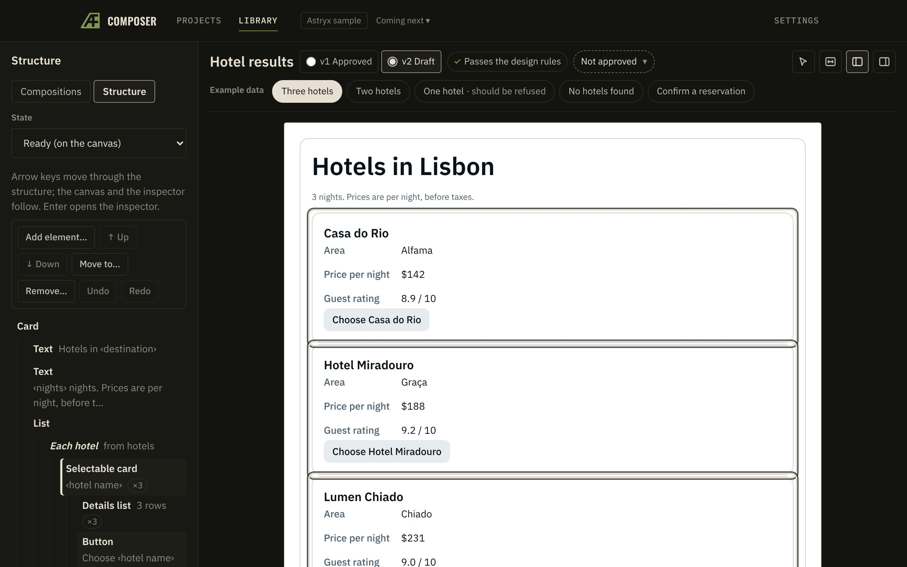 | 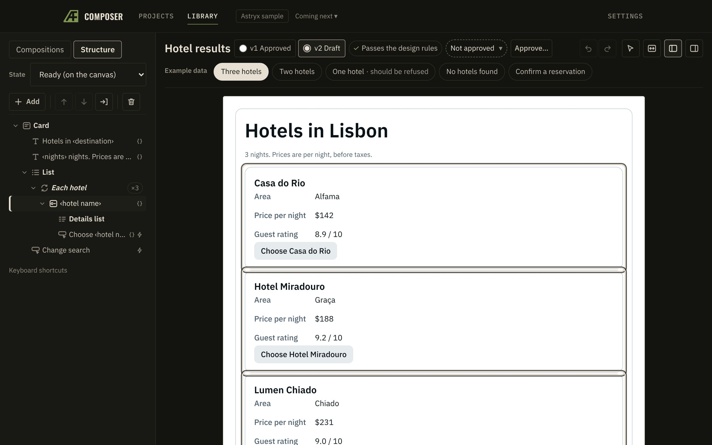 |
| 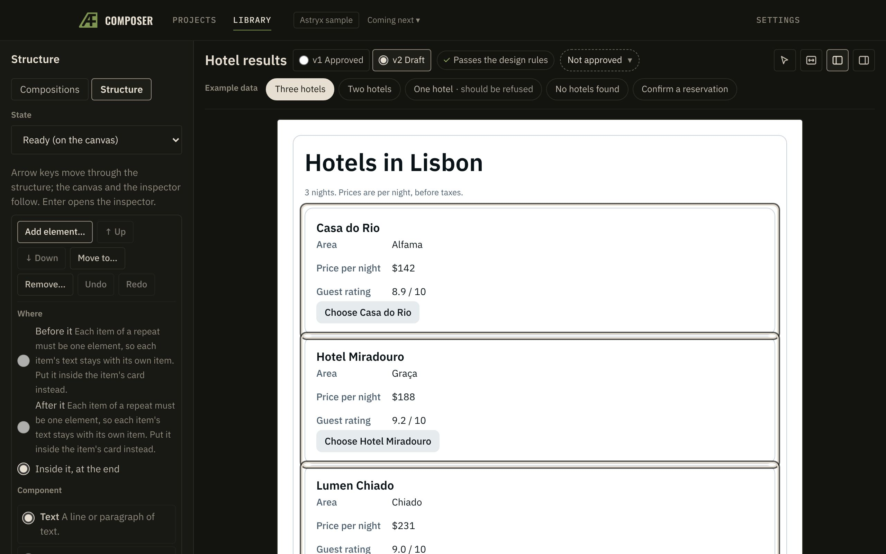 | 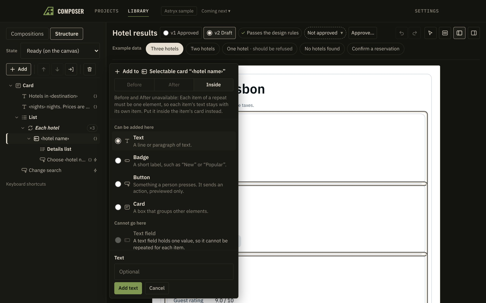 |
| 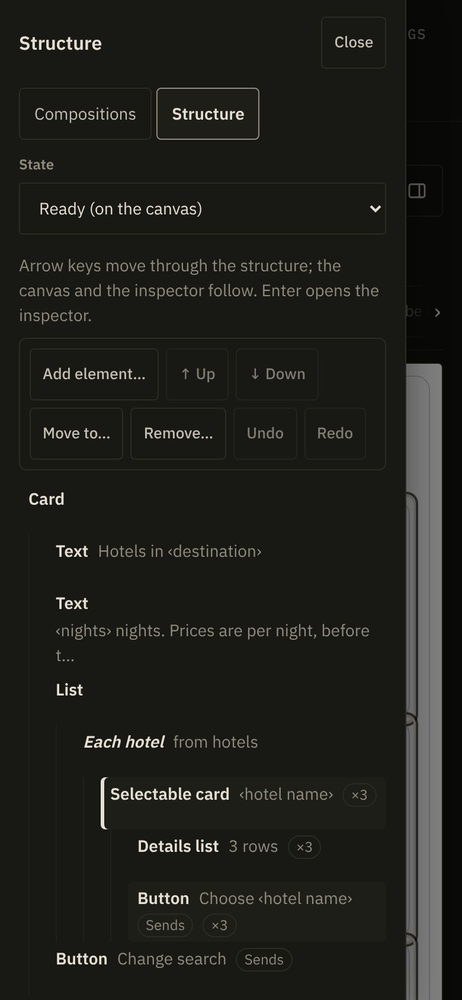 | 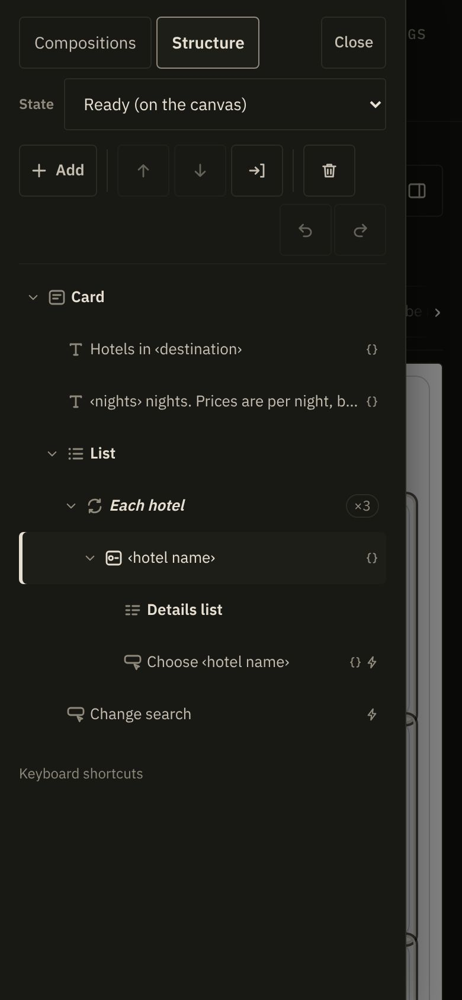 |
| 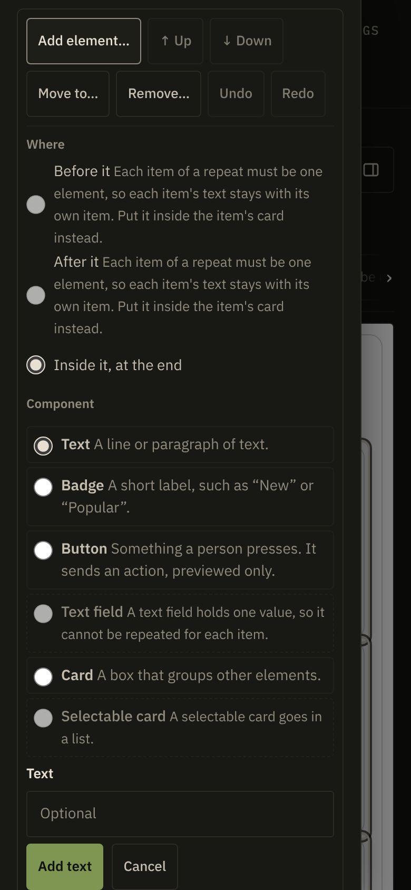 | 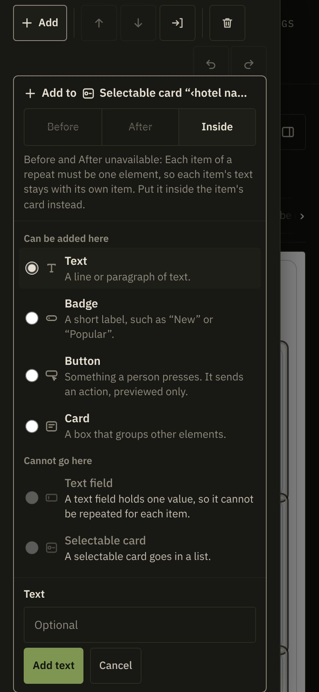 |

| After only | |
|---|---|
| 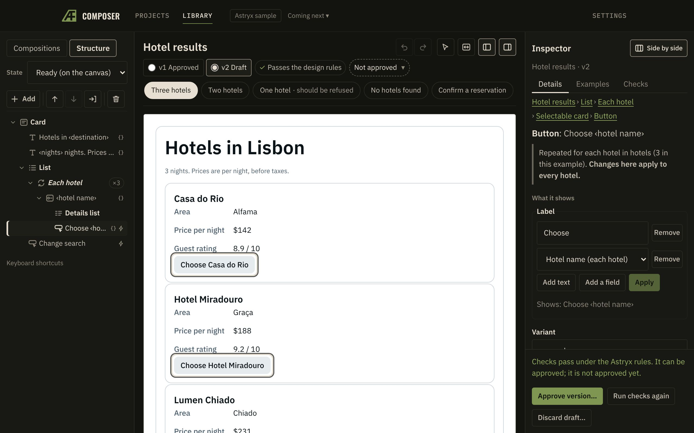 | 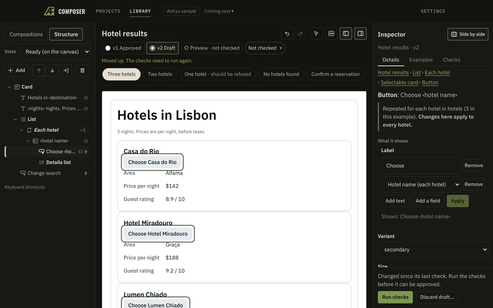 |
| Side by side at 1280 (J2) | An edit in Structure, said under the canvas toolbar; Undo beside it |
| 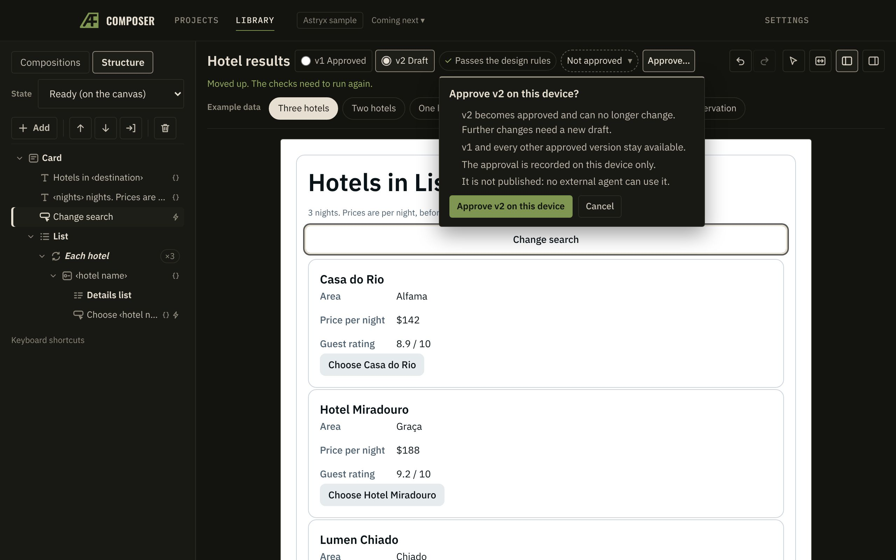 | 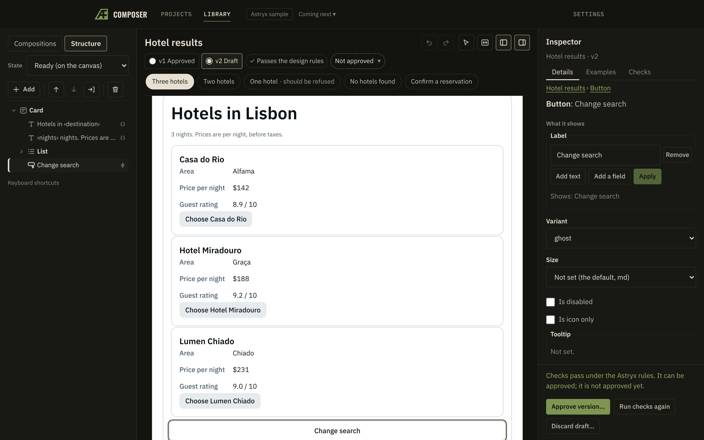 |
| Approve in place, inspector closed | A collapsed list, Structure and inspector at 1440 |
| 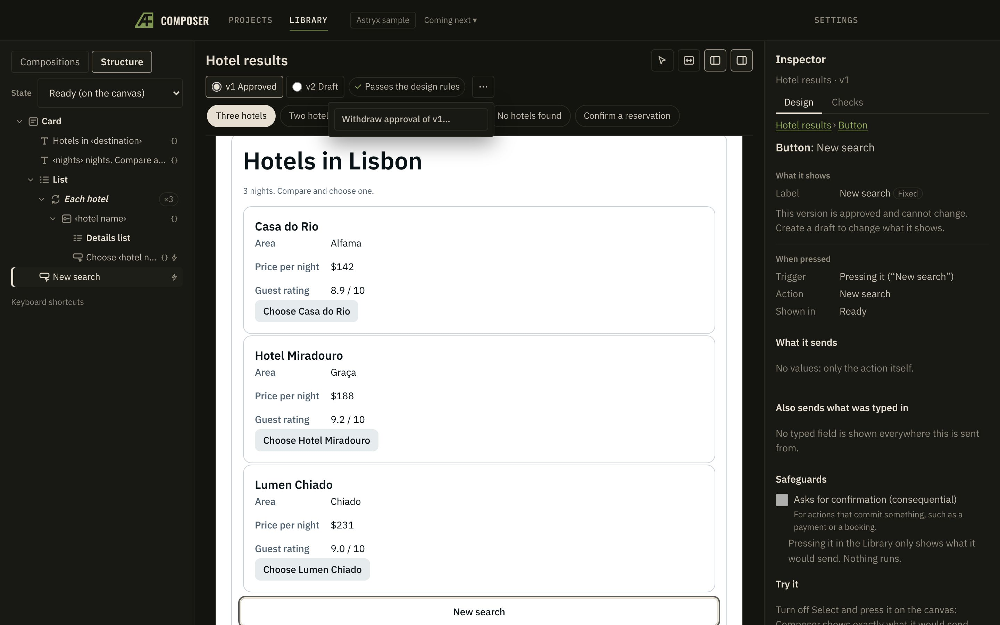 | 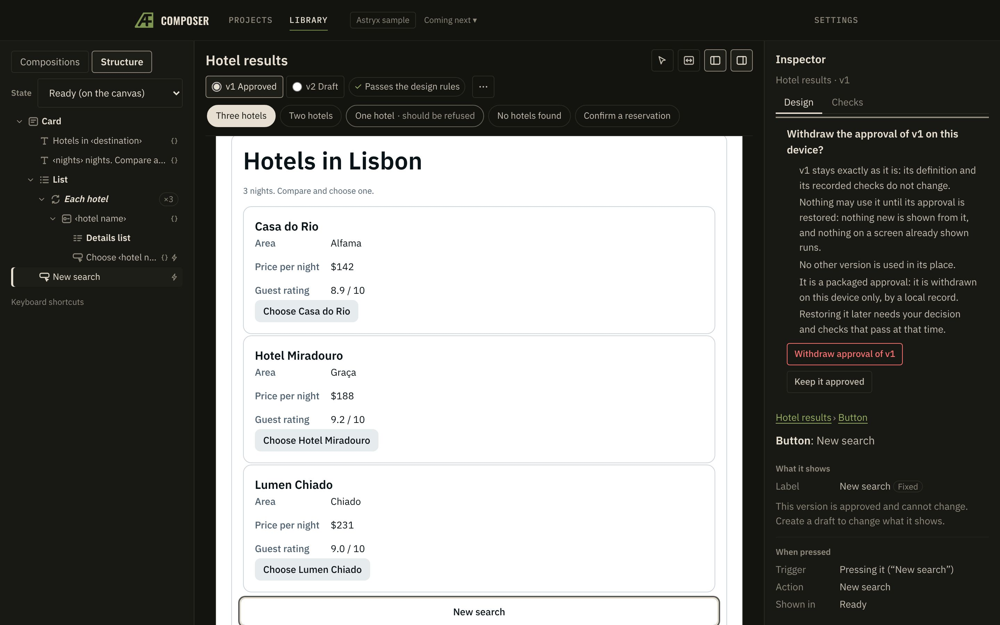 |
| The version menu (J4) | Withdraw with an element selected |
| 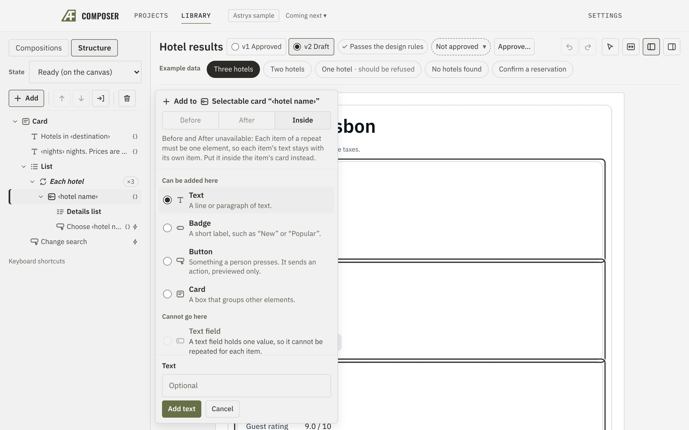 | 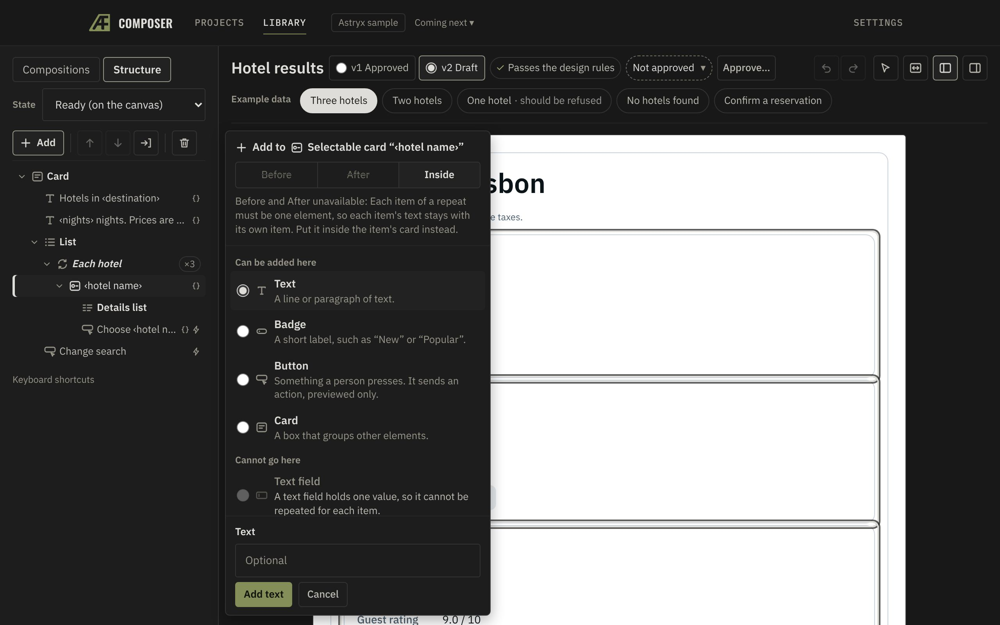 |
| Neutral light | Neutral dark |
| 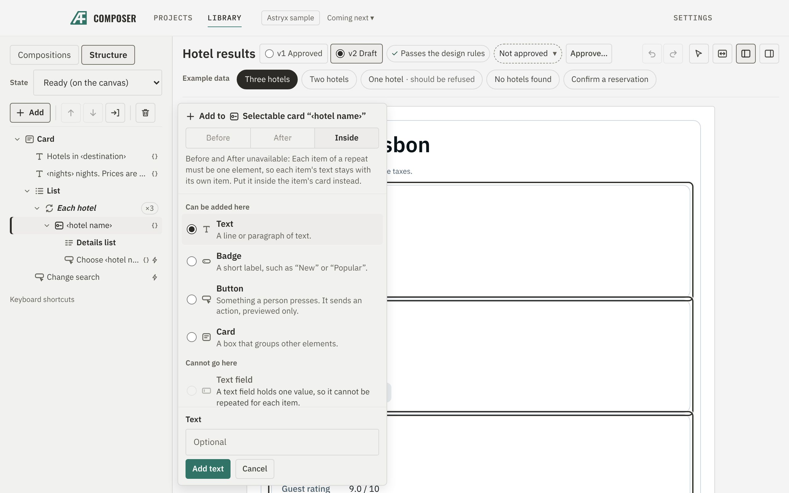 | |
| Custom (light, amber) | |

## Evaluate it

From a clone of dspack-studio, on this branch:

```bash
pnpm install && pnpm --filter composer build:experimental
```

```bash
COMPOSER_OUT_DIR=out-experimental PORT=3315 node e2e/serve-composer.mjs
```

Open http://localhost:3315, choose **Library**, then **Hotel results → v2 Draft**, then **Structure**. At 1280 px:

1. Collapse **List** with its chevron, and open it with the → key.
2. Select **Choose ‹hotel name›**: the canvas outlines it.
3. Choose **Add**: the picker opens beside the panel and says why Before and After cannot be used. Add a **Button**.
4. With a row focused, press **Alt+↑**, then **Delete** (it asks first), then **Escape**.
5. Use **Undo** in the canvas toolbar.
6. Choose **Run checks** beside the draft chip, then **Approve…**: the confirmation opens in place.
7. Open the **Inspector** and choose **Side by side**: Structure stays open beside it.
8. On **v1 Approved**, with an element selected, choose **⋯**, then **Withdraw approval…**.

## Not changed, by decision

- Drag and drop.
- New insertable components.
- State, condition or repeat authoring.
- Block promotion and discovery.
- The meaning of checks, approval or withdrawal.
- A new icon dependency.

Undo still covers element and structure edits only (decision 62).

## Carried forward, not resolved here

- **Withdrawal (decision 56):**
  - A restoration in another tab reaches an open tab only on reload.
  - A consequential commitment opened before a withdrawal can still be settled.
  - Withdrawal is local to this device.
- **Sensitive data (decisions 52 and 53):** before any external agent consumption, every approved version, including the packaged Hotel search v1 with its unmasked private field, must meet the current sensitive-data requirements. This presentation work does not satisfy that requirement.
