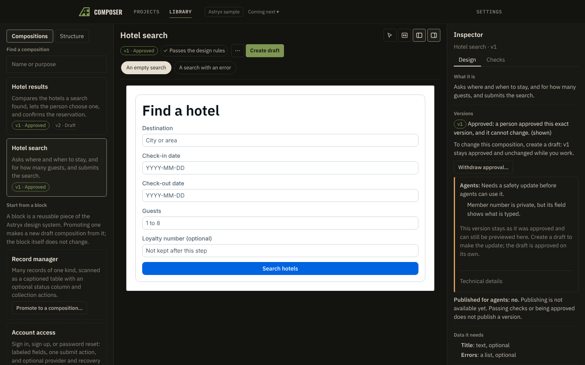
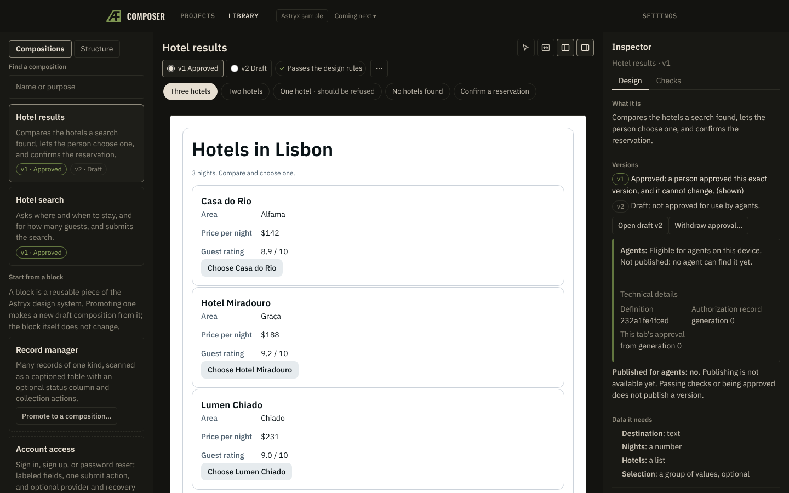
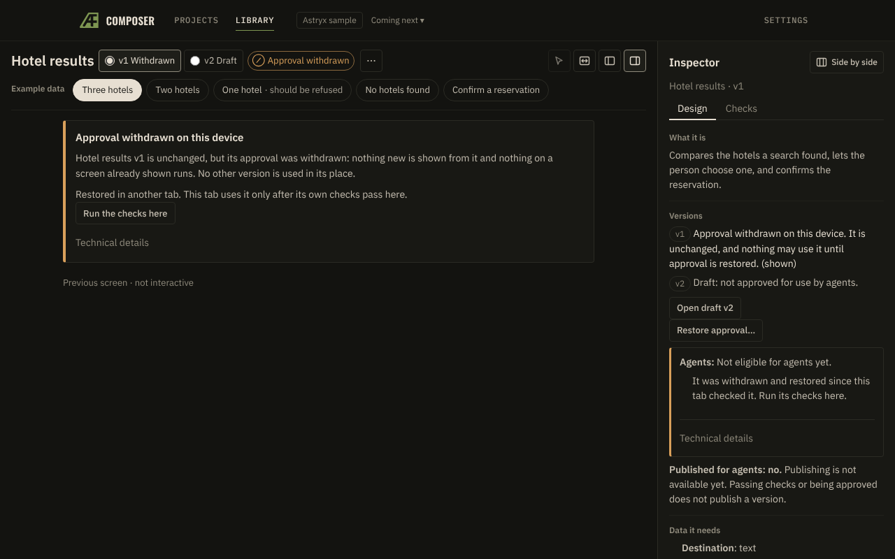

# Authorization and sensitive-data safeguards before agent-facing discovery

**Status:** implemented for the product owner's evaluation, 2026-11-28 (decisions 82 to 86). **Not merged or deployed.** Experimental build only; the default application is unchanged. No new dependency, service, Cloudflare change or sibling-repository change.

The requirements were recorded on 2026-11-28 (decision 80) and authorized for implementation in priority order: R1, R4, R2, R3. This record says what each one enforces, how, and what proves it.

## R1: cross-tab authorization integrity

**The defect, reproduced first** (`failing-first.txt`). Each tab rewrote the localStorage authorization record from its own in-memory copy, and a tab refreshed that copy only when a withdrawal touched a host it held. The browser test reproduced it:
1. Tab A opens.
2. Tab B approves a draft on this device and withdraws it.
3. Tab A withdraws another version.
4. After a reload, B's version is authorized again.

That test failed on the old code. Re-reading before writing would not have been enough: localStorage has no atomic read-modify-write across tabs.

**The correction** (`apps/composer/experimental/workspace/authority.ts`):
- **One transaction per change.** The record moved to IndexedDB, which is built into the browser. Each change is one readwrite transaction (read, apply one change, write), and the browser serializes those across every tab of the origin. Nothing is written from a copy held in memory.
- **Changes are exact:**
  - withdraw adds exactly one entry;
  - restore is a compare-and-set on the withdrawal it saw, so it never removes a newer withdrawal;
  - rollbacks (undo a withdrawal the host refused, reinstate after a refused restoration) are transactions of the same kind.
- **Other tabs are told, and never trusted.** A change is announced on a BroadcastChannel. Every tab re-reads the record, and also re-reads it before showing an approved version, so a lost message cannot leave a tab authorizing what was withdrawn.
- **A restoration in another tab authorizes nothing here.** This tab says "Restored in another tab. This tab uses it only after its own checks pass here" and offers to run them.
- **Fail closed.** Without IndexedDB the authority is unavailable:
  - a withdrawal applies in this tab only, and says so;
  - nothing can be restored;
  - nothing is eligible for agents.
  A stored record that is not exactly the version-2 shape authorizes nothing.

**Evidence:**
- Browser, two real tabs (`composer-authority.spec.ts`): the reproduced sequence now holds after a reload; concurrent withdrawals are both kept; a restoration elsewhere is said, and this tab is used only after its own checks.
- Unit (`withdrawal.test.ts`):
  - the old write, reproduced exactly, loses an entry; the same interleaving through the authority keeps both;
  - compare-and-set against a newer withdrawal;
  - persistence failure and rollback;
  - the unavailable authority.

## R2: persistent stale-authorization protection

- **Record version 2** keeps a persistent `generation` counter, raised by every change. Ordering never uses the wall clock; `withdrawnAt` is for people only.
- **Withdrawals are bound to the exact definition** (sha256) and the generation that made them.
- **Restored withdrawals are kept in `history`.** An approval obtained before a withdrawal can never become valid again because the version was later restored.
- **Approvals are bound to a generation.** Each tab binds every approval it holds to the generation read *before* its check ran. A version is used only if it is not withdrawn and the approval is at least as recent as the latest withdrawal of that definition, current or restored (`approvalStanding`).
- **Edits keep one identity.** A definition is now kept exactly as the loader reads it back (decision 81), so it hashes the same in a session and after a reload. Before, an edited definition's keys could be ordered differently after a reload, and a withdrawal keyed on its hash could miss it.
- **Migration is conservative** (corrected, decision 87):
  - A version-1 record is moved in once, and every entry stays withdrawn, with an ordering generation.
  - Entries are marked `legacy` and apply to their composition and version whatever the hash. Their hash was taken before definitions were normalized, so matching by hash alone could let a reordered serialization of the same definition through.
  - The version-1 record is never cleared or rewritten. The version-2 record existing is what prevents a second migration.
  - Only a genuinely absent record means "nothing withdrawn". A malformed, other-version or unreadable record is evidence that withdrawals may exist. Then nothing is written, the record is kept as it is, and every approval on this device is blocked, with the reason said in the inspector.
- **An approval is bound to the generation its checks began under** (corrected, decision 87). This covers restorations made here and approvals restored in another tab.
  - If anything withdrew the version while the checks ran, even if it was restored again since, the restoration is refused and fresh checks are needed.
  - An older check is never given a newer generation.
- **Exact definition identity** (corrected, decision 87):
  - A withdrawal names one exact definition: composition, version and hash. Withdrawing one definition never erases another's withdrawal under the same composition and version.
  - A restoration removes exactly the withdrawals its checks began under (compare and set).
  - Two tabs cannot approve different definitions as the same version: the second approval is refused, not written over the first.
- **Evidence stays evidence.** Stored check evidence (`approvals`) is still never accepted as authorization.

**Evidence:**
- Unit tests:
  - migration;
  - shape validation;
  - stale approval after a restoration elsewhere;
  - generations through withdraw, restore and rollback.
- Browser: the restoration-elsewhere test.

## R4: agent eligibility and sensitive data

**One gate:** `eligibility.ts agentEligibility`. Discovery, when built, reads only this. It is evaluated every time it is asked, from the authority as it is then, and never stored. It is not publication.

A version is eligible only if:
1. it is an exact approved version;
2. the authority is available;
3. it is not withdrawn, **and** this tab's authorization of it is not stale: an approval obtained before its latest withdrawal never counts, even after a restoration;
4. its latest check passed for exactly this definition under the current contract, profile and toolchain (the same pins the host compares);
5. it meets the current sensitive-data rules;
6. nothing from a block it was promoted from is unresolved;
7. every intended next state is reached by an example.

**Sensitive data:**
- A private field must be masked (unchanged).
- New: a field drawn as a password but not declared private blocks a new approval until it is made private, through its own fix ("Make it private").
- A private value is redacted from everything recorded. It is never stored, never put into diagnostics and never carried into a replacement (existing host guarantees, re-asserted in tests).
- **Hotel search v1** stays byte-identical (its hash is pinned in tests) and usable in the Library's synthetic preview. It reads "Needs a safety update before agents can use it", because its private loyalty-number field is unmasked.

**Promotion (decision 82):** checks between fields that a block had and a composition cannot carry no longer just appear as "not carried".
- While the composition still reads every field a check constrains, data that breaks it would be shown, so approval waits.
- A check is genuinely resolved only when the composition no longer reads a field it constrains. Field reading is over-approximated, so this fails closed.
- Unknown kinds of check always block.
- auth-form's checks are resolved by removing its repeated fields. records-table's check stays blocking while its table shows columns and rows.

**In the inspector:** the Versions section shows **Agents:** with the headline and the reasons in words. Identities and generations sit under **Technical details**.

| | |
|---|---|
|  |  |
| Hotel search v1: needs a safety update | Hotel results v1: eligible, not published; technical details opened |
|  | |
| Restored in another tab: said, and not eligible here until checked here | |

**Evidence:**
- `eligibility.test.ts` (6): Hotel results v1 eligible; Hotel search v1 ineligible and pinned; each other cause; the password rule; redaction.
- `promotion.test.ts`: checks between fields.
- Browser: the eligibility tests in `composer-authority.spec.ts`, and the updated promotion walkthrough.

## R3: the pending commitment lifecycle

The Library previews actions and never dispatches them, so this is the host's lifecycle, with a device journal for when consequential actions run here. Nothing is executed.

- **Core** (`host.ts`):
  - A commitment names the exact version, definition (sha256) and approval issue it was accepted under.
  - A host can be given a **journal**. A commitment is kept *before* it is accepted: if it cannot be kept, it is not accepted (`unrecorded`), and nothing is represented as accepted. An outcome that cannot be kept is not reported as settled.
  - A new host can be given the **pending** commitments of exactly the definitions it governs. They are re-attached settle-only: they can be queried and settled by their key, never dispatched again.
  - While an earlier commitment of the same action is pending or unknown, a new one is refused as a duplicate. Withdrawal still refuses every new action, and an accepted commitment can still be settled.
- **Workspace** (`commitments.ts`):
  - Each commitment is its own localStorage entry under its idempotency key, so two tabs never rewrite each other's entries.
  - Across hosts (corrected, decision 87): the journal re-reads what is stored at each step.
    - A kept key is never accepted again.
    - An open commitment of the same action for the same definition, kept by another host (another tab), refuses a second one.
    - A kept outcome moves only along the lifecycle, so a terminal outcome is never overwritten, whichever host reports it ("conflict").
  - Only metadata is kept: key, composition, version, sha256, action, component, status, history, and the authorization generation at acceptance. No payload, typed value or tool response is kept.
  - A commitment accepted before a withdrawal is said to be (`acceptedBeforeWithdrawal`). The inspector lists open outcomes for a version when there are any.

**Evidence:** `commitments.test.ts` (5):
- kept before acceptance, metadata only;
- re-attached after a reload and refused as a duplicate;
- settled after a withdrawal and a reload, accepted-before-withdrawal said, and nothing re-dispatched on restoration;
- persistence failure for acceptance and for settlement;
- a different definition is not re-attached.

## What remains of the device-local model

- **This browser profile only.** Another device or browser has its own authority. A withdrawal is not seen elsewhere, and there is no shared authority to consult. This needs a server-side authority before agents consume compositions.
- **Clearing site data** clears the authority, the drafts and the journal together. A version withdrawn here and then cleared reads as authorized again. The server-side authority above removes this case.
- **BroadcastChannel and IndexedDB** are needed for safe concurrency. Where IndexedDB is unavailable, the model fails closed. Where BroadcastChannel is absent, tabs still re-read before showing, but they learn of a change only then.
- **Commitments: local and synthetic only.** The journal is kept in localStorage, which has no cross-tab transaction.
  - Two tabs pressing the same consequential action at the same instant can both pass the duplicate check before either has written.
  - A crash between keeping and accepting leaves a kept-but-unaccepted entry, which reads as open and blocks a duplicate: the safe direction.
  - This journal is not sufficient for real external transaction execution, and must not be presented as such. Real consequential dispatch needs the server-side commitment and idempotency record first (`../discovery/SERVER-AUTHORIZATION-PROPOSAL.md`).
- **Eligibility is computed, not enforced against an agent,** because no agent consumes compositions yet. Discovery must call `agentEligibility` at request time and nothing else.
