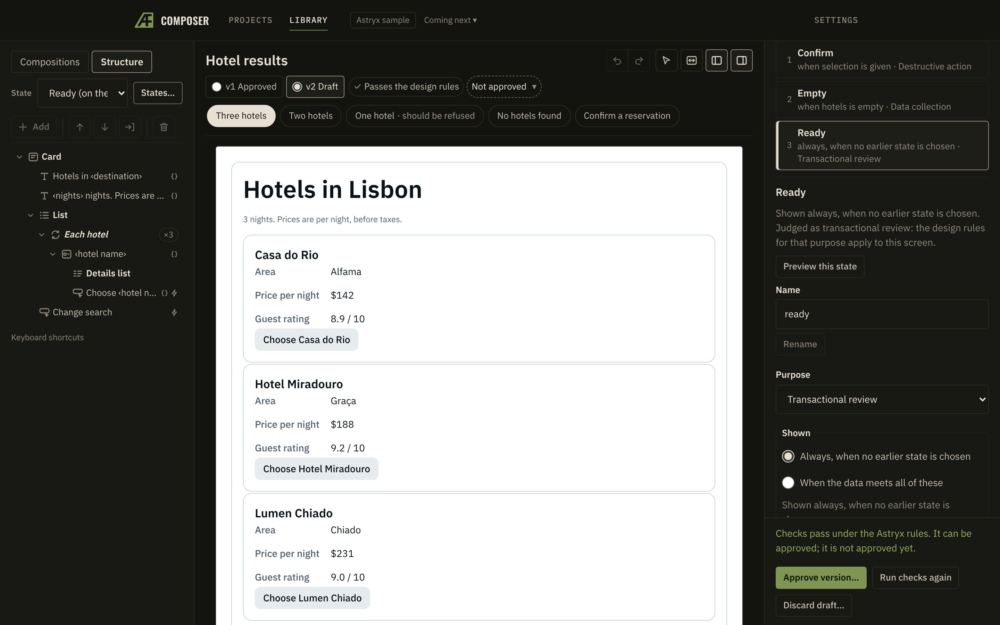
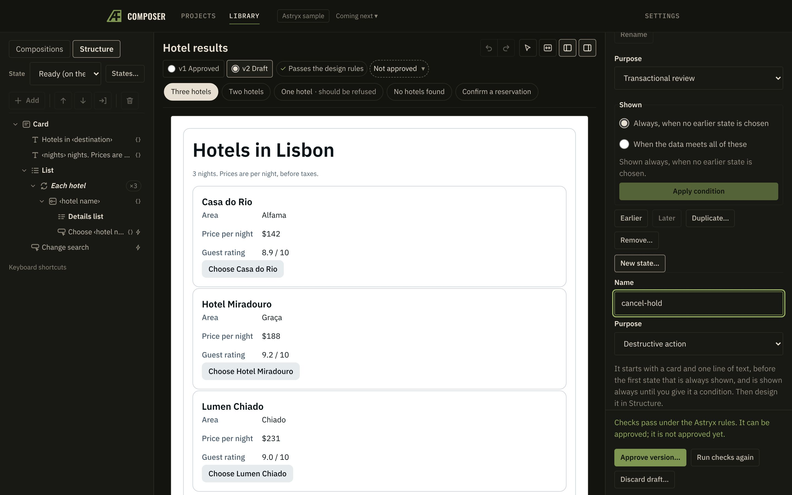
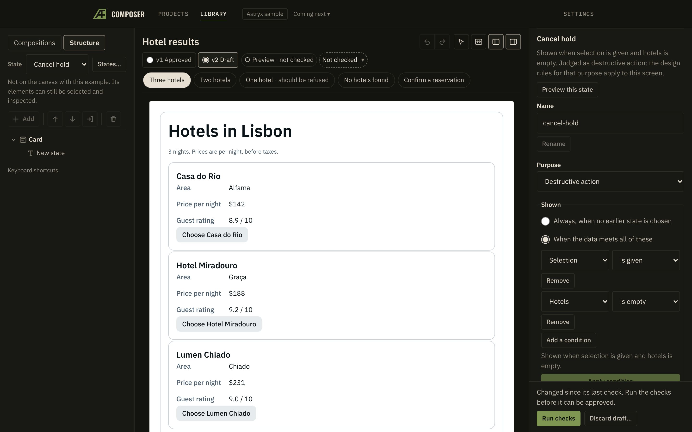
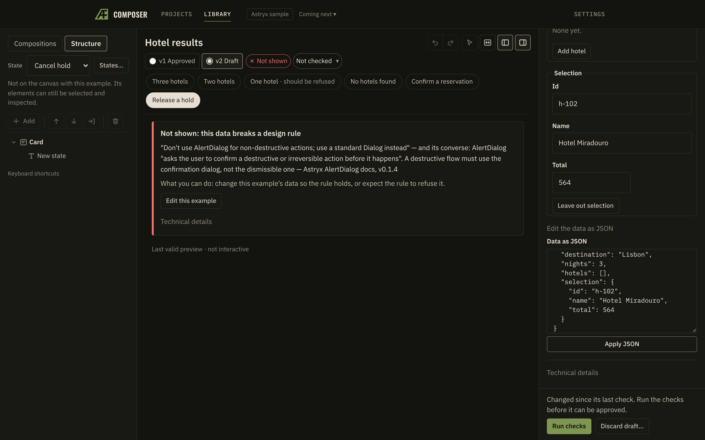
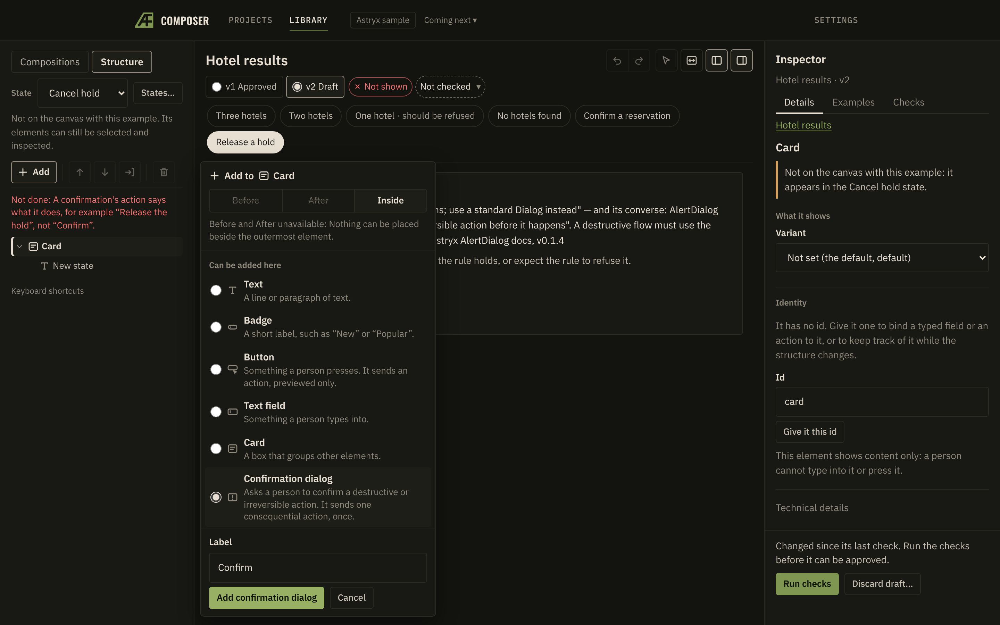
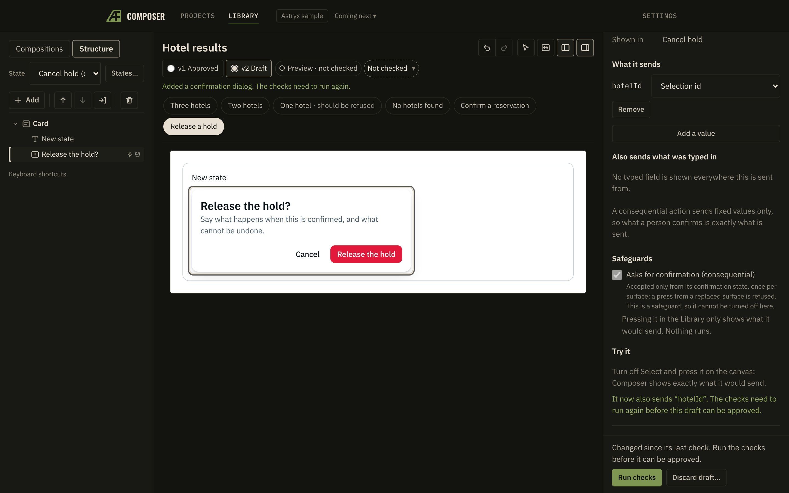
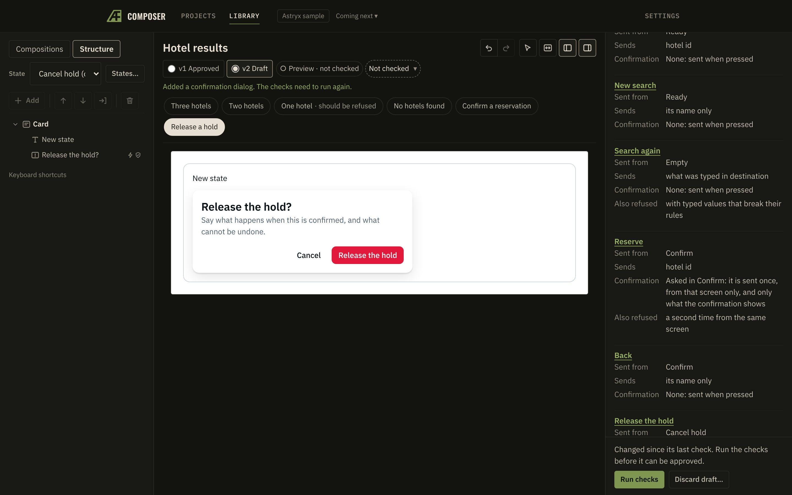
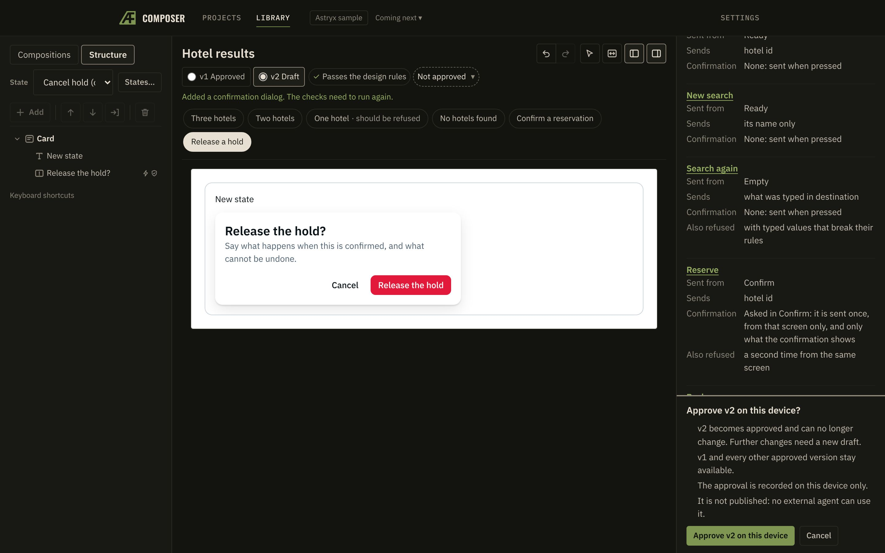
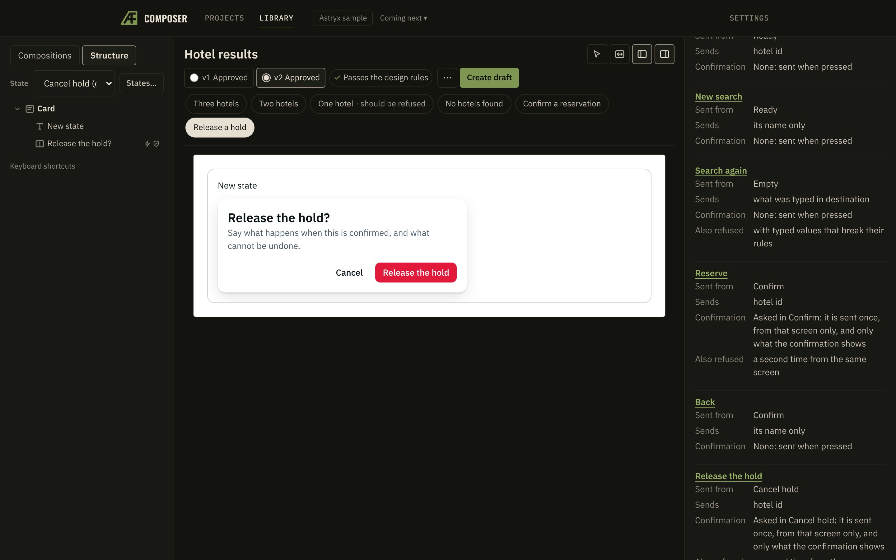
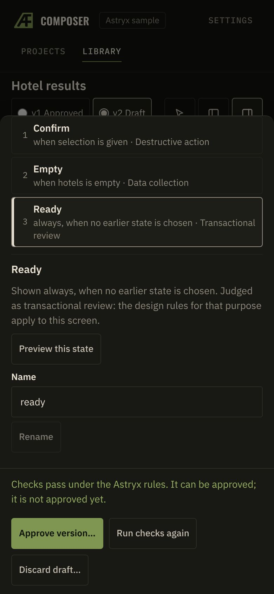

# M1 state, transition and dialog authoring (slices A to C)

**Status:** implemented for the product owner's evaluation, 2026-11-28. **Not merged or deployed.** It is in the experimental build only; the default application is unchanged.

All of it uses the existing composition schema, loader, expansion model, host safeguards and governed pipeline:
- the pure state operations are in `packages/composer-core/src/compositions/states.ts`;
- the workspace's States section and action view are in `state-editor.tsx`;
- dialogs come through the existing component picker.

There is no new editor, schema, runtime or shell.

## The model, as it already was

A state is a screen of the composition. It has an id, the contract intent it is judged under (its *purpose*), a *condition* over the data in the closed guard forms, and its own template.

**The data chooses the state.** The first state, in order, whose condition holds is shown. An example may ask for a state, which is shown if its own condition holds.

**Actions never change the screen by themselves.**
1. The agent receives an action.
2. It answers with data.
3. That data chooses the next state.

## What a designer can do

### Slice A: states

These controls are on a draft, under the inspector's **States** section. **States…** beside Structure's State selector opens it.

| Control | How it works |
|---|---|
| **New state…** | A name and a purpose. The state starts as a card with one line of text. It is placed before the first state that is always shown, so nothing after it is lost |
| **Name** | Renaming updates every action and example that names the state, in one step. A name already used is refused |
| **Purpose** | One of the contract's intents. Its design rules then apply to that screen |
| **Condition** | Typed controls only: **always**, or **all of** these tests: a declared field *is given*, *is empty*, or (for a list) *has at least N items*. Only declared fields are offered. The condition is said in words ("Shown when selection is given and hotels is empty") |
| **Earlier / Later** | The order the data chooses in. A state that can never be chosen, because it comes after one that is always shown, is said as such, with the remedy |
| **Duplicate…** | The copy has the same elements (same ids, same typed fields) and is sent the same actions. A confirmation state is not duplicated, because its consequential action belongs to exactly one state |
| **Remove…** | Says first what depends on the state: actions removed or no longer sent from it, typed fields removed, examples that stop asking for it. Those change only in the same step. The last state stays |
| **Preview this state** | The canvas shows it through the governed pipeline, as an example's request would. It is refused, with the reason, if the example's data does not meet its condition |

- **Templates:** each state's template is edited in Structure, with the existing tools.
- **Examples:** an example names the state it asks for and the outcome it expects, in the Examples tab.
- **Undo:** state edits are not part of Undo, which still covers element and structure edits only (decision 62). An undo step that a later state edit conflicts with is refused, with the reason, and nothing changes.

### Slice B: what actions do

The **What actions do** section covers every declared action:
- **Sent from:** the states it is sent from. These can be edited among the states that show its element; a consequential action keeps exactly one.
- **Sends:** its literal payload and the typed fields it carries.
- **Confirmation:** a consequential action is asked in its confirmation state, sent once from that screen only, and sends only what the confirmation shows.
- **Then:** the agent answers with data, which chooses the next state by the conditions above.
- **Refused:** when sent from a screen that is no longer current, or a second time.

**The limitation, kept explicit.** The schema cannot declare *which state an action leads to*. That is decided by the data the agent returns. Designer-authored next-state intent would need a small extension, which is proposed for approval in [TRANSITIONS-PROPOSAL.md](TRANSITIONS-PROPOSAL.md) and **not implemented**.

### Slice C: dialogs

The picker now offers **Dialog** and **Confirmation dialog**, only where the contract's rules and the host's safeguards hold.

| Component | Offered | Not offered, with the reason |
|---|---|---|
| **Confirmation dialog** | In a state whose purpose is Destructive action. It is declared with a consequential action, sent once from that state | In other states ("belongs in a state whose purpose is Destructive action"); inside a dialog; in a repeat; or a second one in a state |
| **Dialog** | In any other state | In a destructive state, which uses a confirmation dialog; inside a dialog ("a dialog is one layer"); in a repeat |

- **Generic labels refused:** a confirmation's action label that is generic ("OK", "Confirm", "Yes", "Continue") is refused before it is added (`rule.alertdialog-action-label-specific`).
- **Safeguards kept:** its title, description and labels are edited in **What it shows**. Its payload is literal or read from data, never typed input. Consequential locking, stale-action refusal and sensitive-data masking are unchanged.

The canvas draws a confirmation in place, as the state's screen.

## The walkthrough (Hotel results)

| | |
|---|---|
|  |  |
| 1. The draft's states, in the order the data chooses | 2. A new state, judged as a destructive action |
|  |  |
| 3. Its condition, in words, and its place first | 4. An example for it: refused, because a destructive state must confirm |
|  |  |
| 5. A confirmation dialog, offered here; “Confirm” is refused as a label | 6. Resolved: the confirmation renders, and sends the selected hotel's id |
|  |  |
| 7. What actions do | 8. Checks pass; approve on this device |
|  |  |
| 9. Approved: the states are shown, not editable | 10. Phone: the states in the inspector sheet, from Structure |

The browser test `e2e/composer-states.spec.ts` performs the same walkthrough.

## Evaluate it

From a clone of dspack-studio, on this branch:

```bash
pnpm install && pnpm --filter composer build:experimental
```

```bash
COMPOSER_OUT_DIR=out-experimental PORT=3315 node e2e/serve-composer.mjs
```

Open http://localhost:3315, choose **Library**, then **Hotel results → v2 Draft**, then **Structure → States…**. Then:

1. Under **New state…**, enter `cancel-hold` with the purpose **Destructive action**.
2. Set its condition to **Selection is given** and **Hotels is empty**, choose **Apply condition**, then press **Earlier** twice.
3. In **Examples**, duplicate **Confirm a reservation**. Title it `Release a hold`, set `hotels` to `[]` in its JSON, and ask for **Cancel hold**. The canvas refuses it, with the rule.
4. In Structure, choose **Cancel hold**, select **Card**, then **Add**, **Inside**, **Confirmation dialog**. Try the label `Confirm` (refused), then `Release the hold`.
5. In **What it sends**, add `hotelId` from **Selection id**.
6. **Run checks**, then **Approve…**.

## Not in this increment

- Next-state declarations (proposal only).
- A visual journey editor.
- New repeats, conditions in templates, and nested repeats.
- Table, Details list and Dropdown menu insertion.
- Undo for state edits.
- State titles and descriptions beyond the id and purpose (part of the proposal).
