# M1 visual template editing (B1 to B5)

**Status:** implemented for the product owner's evaluation, 2026-11-27. **Not merged or deployed.** Experimental build only; the default application is unchanged.

**Stacking.** This is stacked on approval withdrawal ([../withdrawal/README.md](../withdrawal/README.md)): its PR targets that branch, so each is reviewed on its own, and the walkthrough ends with a withdrawal.

On a draft, a designer can now:
- change what an element shows;
- give it an id or rename one;
- insert components from the Astryx vocabulary;
- move, reorder and remove elements.

All of this happens in the Structure view, the contextual inspector and the canvas the workspace already has. Every change is one edit of the draft's own templates, inputs and actions:
- it goes through `editDraft` and the packaged loader;
- it is previewed through the governed pipeline;
- it makes the draft's checks stale.

There is no new schema, expression language, editor or shell.

## What a designer can do

| | In the interface | Underneath |
|---|---|---|
| **B1 What it shows** | Inspector, **What it shows**, on a draft. A text or label is a short list of parts: **fixed text** or **a field**, each chosen from a list, then **Apply**. Style, size, type and similar props use the contract's own values. An element with an id that appears in several states changes in all of them, and says so | The existing template language only: a literal, `{ $prop }` (with its fallback kept), or `{ $concat }`. Fields offered are the declared data and parameters, their object fields, and inside a repeat the item's fields. Props are the contract's own (`editableContent`). A field's `type` stays with **Private**, which masks it |
| **B2 Identity** | Inspector, **Identity**: **Give it this id**, or **Rename** | `assignId` and `renameId` (composer-core `template.ts`). Ids are unique across states and never emitted alike. A rename updates, in one operation, the nodes in every state, the inputs and actions bound to it (an action is named by its node, as the emitter names it), and any repeated action whose list it is. The selection follows the new key |
| **B3 Insert** | Structure, **Add element…**: before, after, or inside; then Text, Badge, Button, Text field, Card or Selectable card. A choice that does not fit says why (“A list holds selectable cards.”, “A text field holds one value, so it cannot be repeated for each item.”) | `insertOptions` and `applyInsert`. A **Button** is declared with its action, and a **Text field** with its typed input, in the same operation, so a button never sends an undeclared action. Inside a repeated item, the button's action is repeated. Its items are told apart by what the list's other action already uses (here the hotel's name), since the binding check refuses an unseen value. Initial props are valid for the contract |
| **B4 Move and remove** | Structure: **↑ Up**, **↓ Down**, **Move to…** a container, **Remove…** | `moveNode` and `removeNode`. Bindings are by id, so a path change never redirects one. **Remove…** says first what depends on the element: “The ‘Show on map’ action is removed.”, “Search stops sending ‘Member number’.” It changes those declarations only as part of the same step. Without dependencies it says nothing else depends on it |
| **B5 Editing** | Select mode keeps the canvas inert, so selecting never presses anything. Structure's tools and the inspector edit; the canvas previews every successful edit. Focus moves to the inserted or moved element, or to the explanation of a refusal. Every result is said beside the control that made it, and Structure edits and undo say what happened in the tools. Escape closes Add, Move to and Remove, and focus returns to the control that opened them. **Undo** and **Redo** (also Ctrl or Cmd+Z, with Shift to redo, outside text fields) | `undo-history.ts`: a session-only history of element and structure steps. Each step records the template, inputs and actions before and after it; undo puts only those back, so details, parameters and examples edited since stay. A step that no longer matches the draft, or that the loader would refuse, changes nothing and clears the history with the reason. The history ends with its draft: discard, approval and a new draft clear it. Undo is an edit like any other: it makes the checks stale and restores no approval |

## Corrections from the independent authoring review (Priority 1)

| Finding | Correction | Evidence |
|---|---|---|
| F1 A boolean prop could not be turned off | Turning it back to the design system's default removes the prop; a prop whose default is on is stored as off | `composer-template.spec.ts` F1 |
| F2 “Not set” could not be chosen for an enum | It removes the prop; the option names the default | F2 |
| F3 Undo reverted later name and summary edits | Undo restores only the template, inputs and actions (decision 62) | `undo-history.test.ts`; F3 (two browser tests) |
| F4 Undo survived Discard and a new draft | The history ends with its draft: discard, approve and create clear it | F4 (discard, and approval) |
| F5 Add could open with nothing to choose | Every position and component is tried on a copy through the loader first; Add opens on one that works, an impossible position says why before anything is chosen, and when nothing fits Add says so without opening | F5 |
| F6 Feedback was far from its control | Results sit under the control that made them and scroll into view; Structure edits and undo report in the tools and in their own live region | F6 |
| F8 Focus fell to the page; Escape closed nothing | Escape and Cancel or Keep it return focus to the opener; an Undo or Redo that disables itself hands focus to the other, or to the tree; opening the inspector from Structure moves focus to it | F8 |
| F16 The removal confirmation overflowed | Its own block inside the tools, naming the element | F16 |
| F13 (part) An unchecked preview read as passing | The pill reads “Preview · not checked”, neutral; the line above the canvas is gone | F16 and status test; `composer-authoring.spec.ts` |

## Integrity, and how it is held

| Guarantee | Held by |
|---|---|
| Existing ids stay stable; new ids are unique and never emitted alike | `template.test.ts` |
| An id change updates every reference atomically, or is refused and changes nothing | `template.test.ts`: rename across two states, its input, its action's name, and a repeat's list; refusals leave the definition byte-identical |
| Structural changes never redirect a binding | Bindings are by id. Tests check every input still binds its field after an insert |
| Removal never drops a binding silently | `dependenciesOf`; removal without resolution is refused, and with it exactly the reported declarations change. Unit and browser tests |
| Repeated items keep their own values after structural changes | Reordering inside each hotel's card, then instantiating under three, reordered and removed examples: every Choose sends its own hotel's id. An inserted repeated button sends its own hotel's id |
| An edit the loader refuses changes nothing, and reads plainly | Moving a button into each hotel's repeat is refused: “Each item of a repeat must be one element…”. Inserting a badge beside the repeated items is refused too |
| Approved versions are preserved | Tests compare packaged v1 byte for byte after editing and approving v2. Approved versions show no editing tools |
| No stale selection | A selection whose element an edit or undo removed is cleared |
| Canvas and workspace isolation | Selection draws beside the canvas frame. The canvas-style and appearance isolation tests still pass |
| The default build carries none of it | `check-default-artifact` refuses `template-tools`, `content-editor` and `identity-editor` |

## Not available, by decision or by the architecture

- **Components not yet insertable:** Confirmation dialog, Dialog, Details list, Table and Dropdown menu. Their props are data-shaped or they need a confirmation state.
  - They can be selected, moved, removed and have their own props edited where those props are text, enums or booleans.
- **New states and transitions,** **conditions** (`$if`) and **new repeats** are not authored here.
  - Content inside a condition can be selected and seen, but not edited.
- **Undo** lasts for the session and covers element and structure edits only (decision 62). Details, parameters and examples are edited in their own fields and are never reverted by undo.
- **Drag and drop** is not provided; every operation has an explicit control.
- **Inserting a Selectable card into a list whose items are repeated** is refused by the loader, because such a list holds only its repeated items.

## Evaluate it

From a clone of dspack-studio:

```bash
pnpm install && pnpm --filter composer build:experimental
```

```bash
COMPOSER_OUT_DIR=out-experimental PORT=3315 node e2e/serve-composer.mjs
```

Then open http://localhost:3315, choose **Library**, and follow the walk below (about fifteen minutes):

1. **Hotel results → v2 Draft.** Open **Structure** (left) and the **Inspector** (right).
2. Select **Button: Change search**. In **What it shows**, change the label's text to `Start over` and **Apply**. Set **Variant** to `primary`.
3. Select the second **Text**. In **Identity**, try `price note` (refused), then `price-note`.
4. Select **Selectable card**. Choose **Add element…**, **Inside it**, **Button**, label `Show on map`, then **Add button**. It appears in every hotel.
5. In **What it sends**, **Add a value**: `hotelId` from **Hotel id**. Press **↑ Up**: it moves above Choose in every card.
6. Select **Button: Start over** and choose **Move to…** **Each hotel**. It is refused, with the reason. Choose **Card** instead.
7. Select **Show on map** and choose **Remove…**: it says its action is removed. Remove it, then **Undo**.
8. Press **Show on map** on a hotel on the canvas: it would send that hotel's id. Nothing runs.
9. **Run checks**, then **Approve version…**. Then **Withdraw approval…** in Versions.
10. Reload: v2 is **Approved · withdrawn**, with every edit. v1 is unchanged.

## Screenshots

Experimental build. Desktop 1440 × 900, phone 390 × 844. Synthetic data.

| | |
|---|---|
| 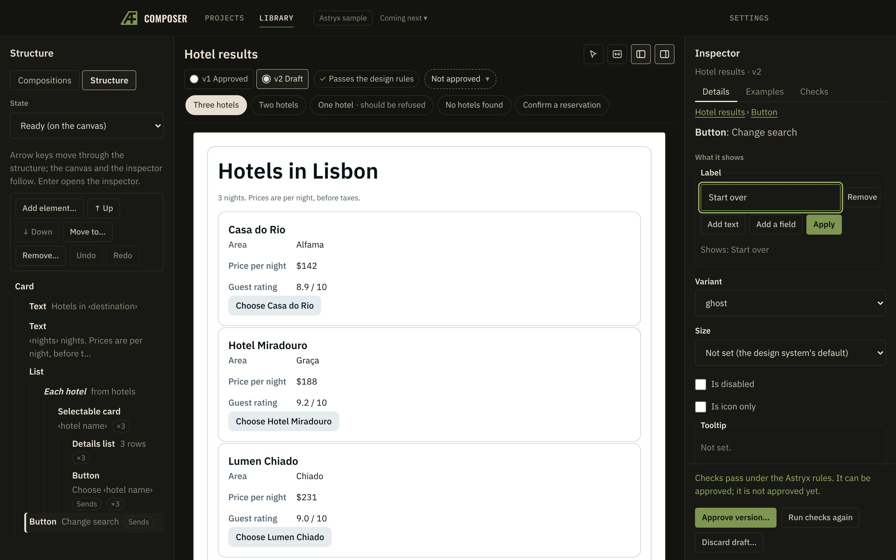 | 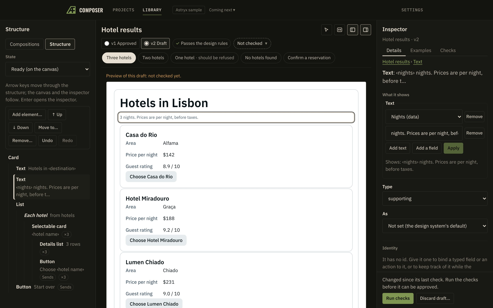 |
| 1. What it shows: the label as parts | 2. Giving an element an id |
| 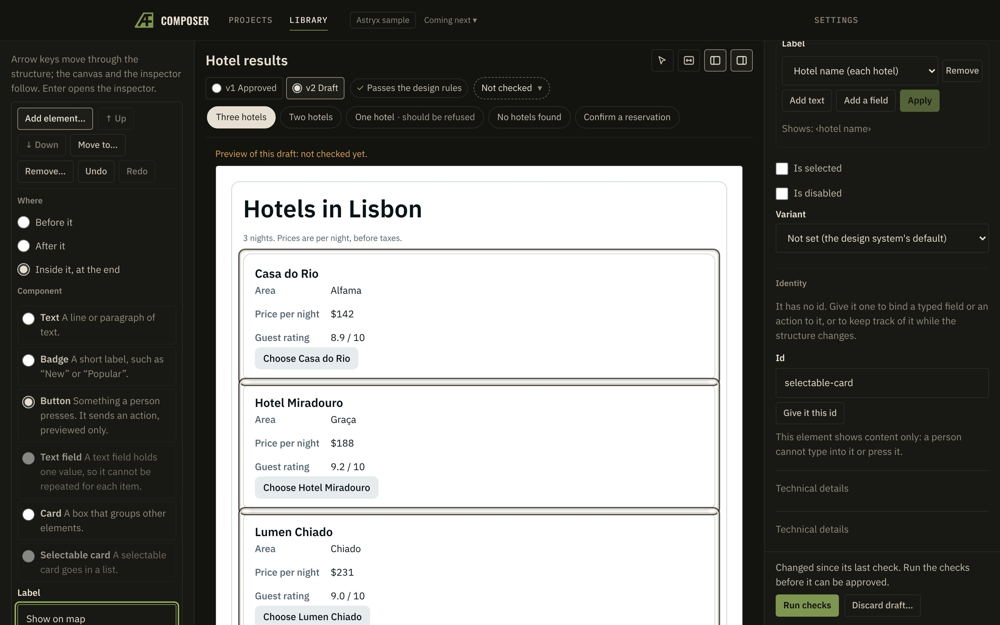 | 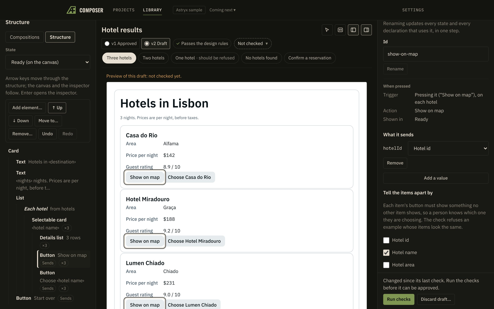 |
| 3. Add element: where, and what fits | 4. Inserted in every hotel, configured, moved up |
| 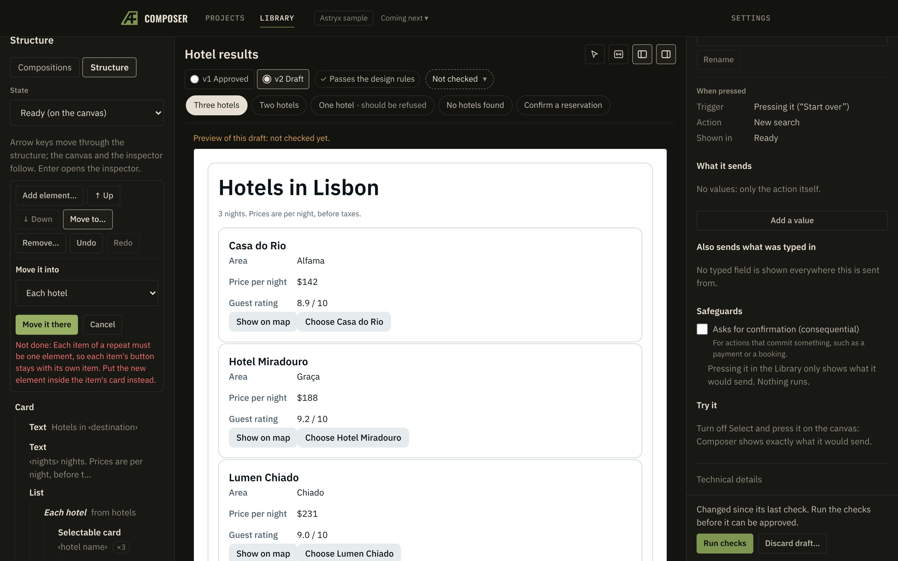 | 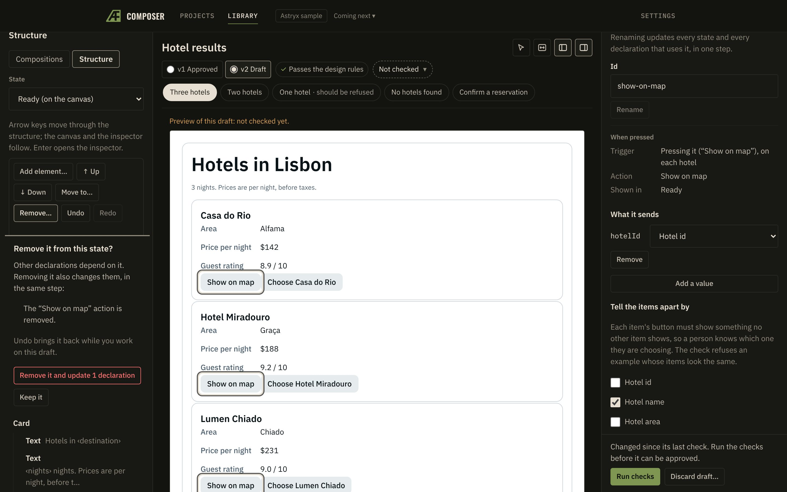 |
| 5. An invalid move, refused with the reason | 6. Removal says what depends on it |
| 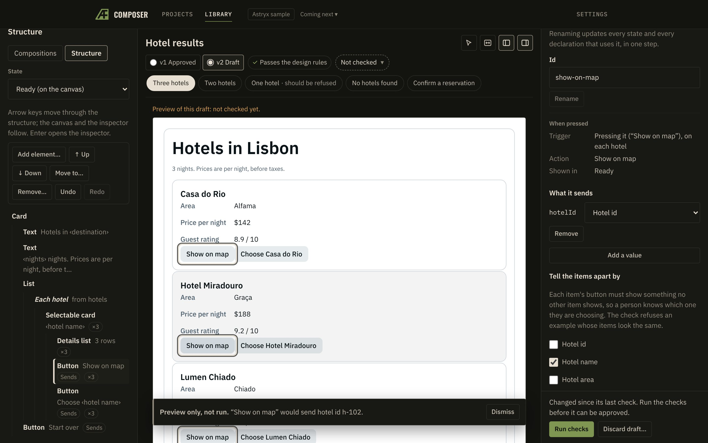 | 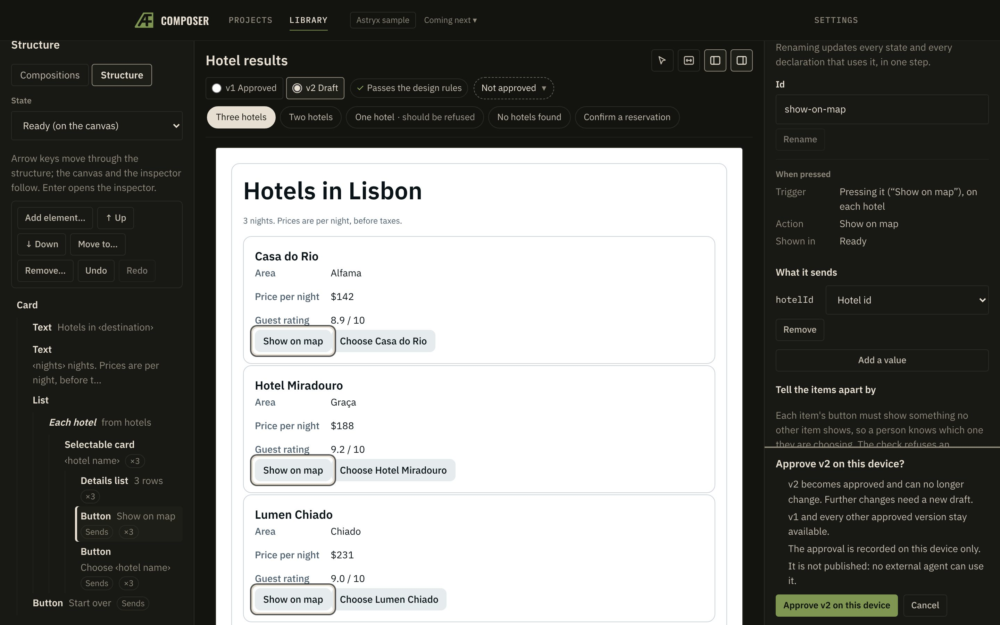 |
| 7. Preview: this hotel's id | 8. Approve on this device |
| 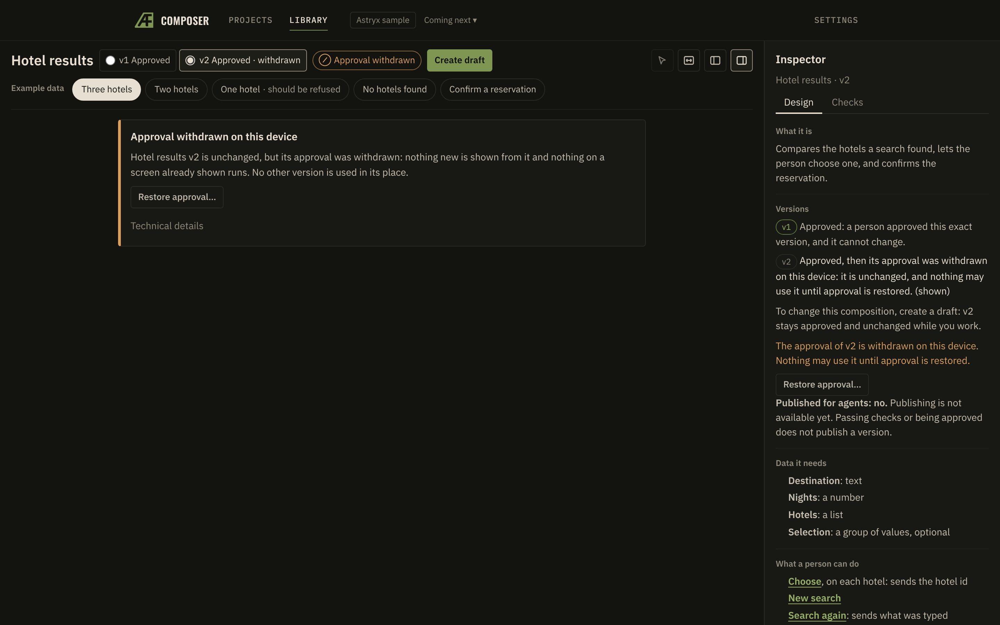 | 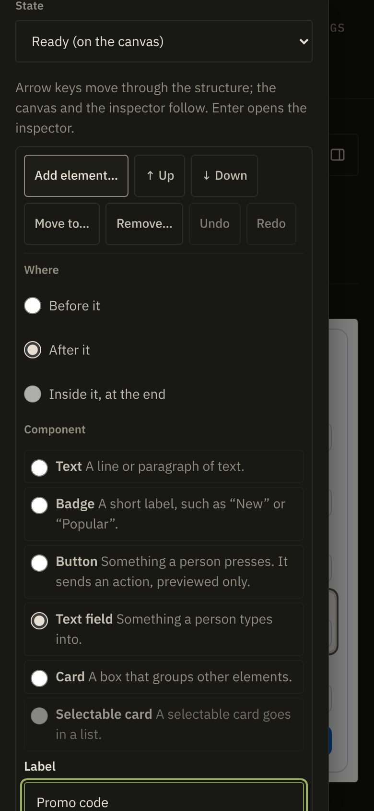 |
| 9. After withdrawal and reload | 10. Phone: adding a text field |
| 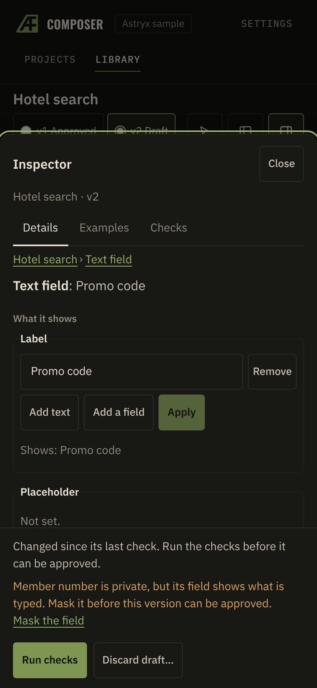 | |
| 11. Phone: the new field's typed input | |
