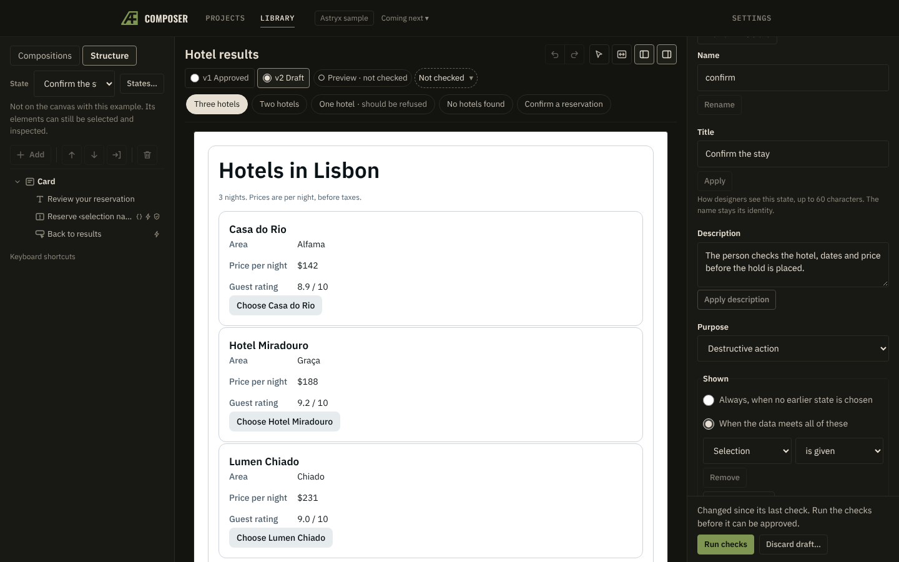
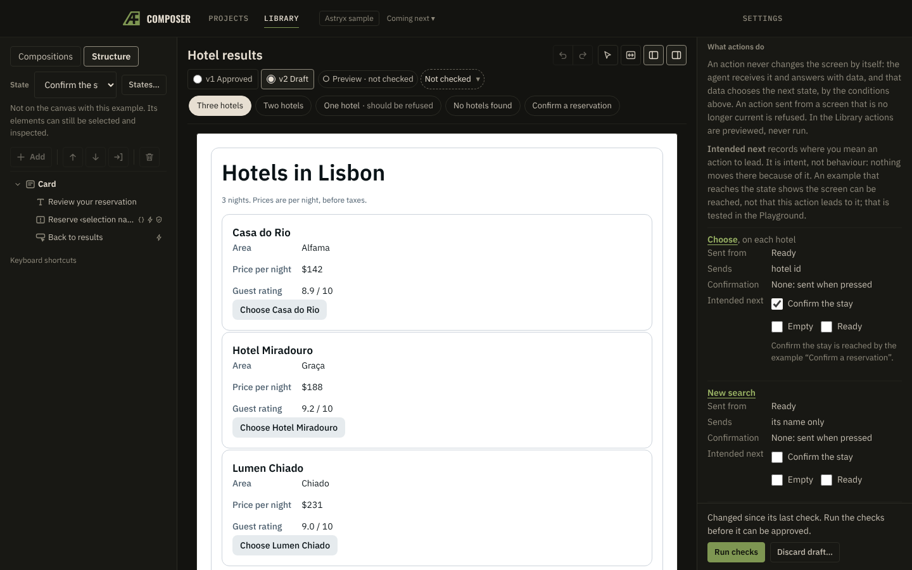
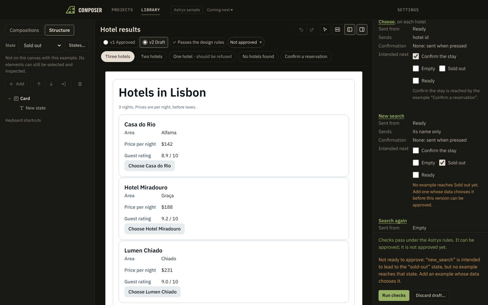

# M1 transition intent (decision 81, composition schema 0.3)

**Status:** implemented for the product owner's evaluation, 2026-11-28. **Not merged or deployed.** Experimental build only; the default application is unchanged.

This is the approved proposal (`../states/TRANSITIONS-PROPOSAL.md`), narrowly scoped. Three optional fields are added:

| Field | Where | Meaning |
|---|---|---|
| `leadsTo` | an action | The states the designer **intends** it to lead to. Intent only |
| `title` | a state | A human name, up to 60 characters. The id stays its identity |
| `description` | a state | What the state is for, up to 240 characters |

## Semantics: intent, never execution

- The host never moves to a declared state. It never refuses data that leads elsewhere, and it never authorizes an action because a `leadsTo` names a state.
- The next state is still the one the agent's returned data chooses (`selectState`).
- What pressing an action actually does is tested in the Playground. That work is not started.

## Validation

| Rule | Where |
|---|---|
| Every target is a state of the composition, named once | Loader (`schema.ts`), and the editing operation (`transitions.ts setLeadsTo`) |
| A consequential action never leads back to its own confirmation state (it is sent from there once) | Loader and editing. The checkbox is not offered |
| Renaming a state carries every intent that names it, in one step | `states.ts renameState` |
| Removing a state reports the intents that name it, is refused without consent, and removes them with it | `states.ts stateDependencies` and `removeState` |
| **Reachability evidence:** each target is reached by an example expected to be shown, using the pipeline's own state selection. Approval waits until it is | `transitions.ts transitionIssues`, enforced in `approveVersion` |

The inspector states what the evidence proves and what it does not: *an example that reaches the state shows the screen can be reached, not that this action leads to it.*

## Compatibility

- **Version 0.3** is 0.2 plus the three optional fields. 0.2 stays strict, so a 0.2 document carrying them is refused rather than misread. A reader that knows only 0.2 refuses a 0.3 document outright (the version is a literal). An unknown version is refused.
- **Existing definitions keep their meaning and their hashes.** Every packaged definition is still 0.2, and its hash is pinned in `transitions.test.ts` to the value from before this change.
- A definition is validated with the oldest version that can hold it (`requiredSidecarVersion`), so a 0.2 draft is judged exactly as before.
- **One identity in a session and after a reload.** A draft is now kept exactly as the loader reads it back. Before this, an edited draft kept its keys in insertion order in the session but schema order after a reload, so the same definition could hash differently. Withdrawals and approvals are keyed by that hash.
- **No parallel schema or runtime.** The fields live in the existing composition schema, loader, persistence and expansion. They change no runtime path.
- **No cross-repository or protocol change.** Composition documents are read only by composer-core. No sibling repository parses them, and no protocol carries them.

## The designer's controls

- **States:** each state's detail has **Title** and **Description**. The list, the state headings and the Structure state selector use the title.
- **What actions do:** each action gains an **Intended next** row, with a checkbox for each state it may lead to.
  - Under it, the evidence is said in words: "Confirm the stay is reached by the example “Confirm a reservation”".
  - Where there is none: "No example reaches Sold out yet. Add one whose data chooses it before this version can be approved".
- **Approval:** the authoring bar says *Not ready to approve: … no example reaches that state*, and Approve is not offered.

| | |
|---|---|
|  |  |
| A state's title and description | Intended next, with its evidence, and what it does not prove |
|  | |
| An intended state no example reaches: approval waits | |

## Evidence

- Core: `transitions.test.ts` (9).
  - Compatibility: hashes before and after; 0.2 refuses the fields, 0.3 holds them; an unknown version is refused.
  - Bounds; integrity (unknown state, consequential loop, rename, remove).
  - Reachability through the pipeline; intent never moves the pipeline.
- Workspace: `transitions.test.ts` (3).
  - The same identity after a reload; packaged hashes unchanged.
  - Approval refused without evidence even when the checks pass.
  - A 0.3 version approved and reloaded.
- Browser: `composer-transitions.spec.ts`.
  - The walkthrough: title, intent, rename, an unreachable target blocking approval, removal, reload.
  - axe at 1440 and 390 px.
