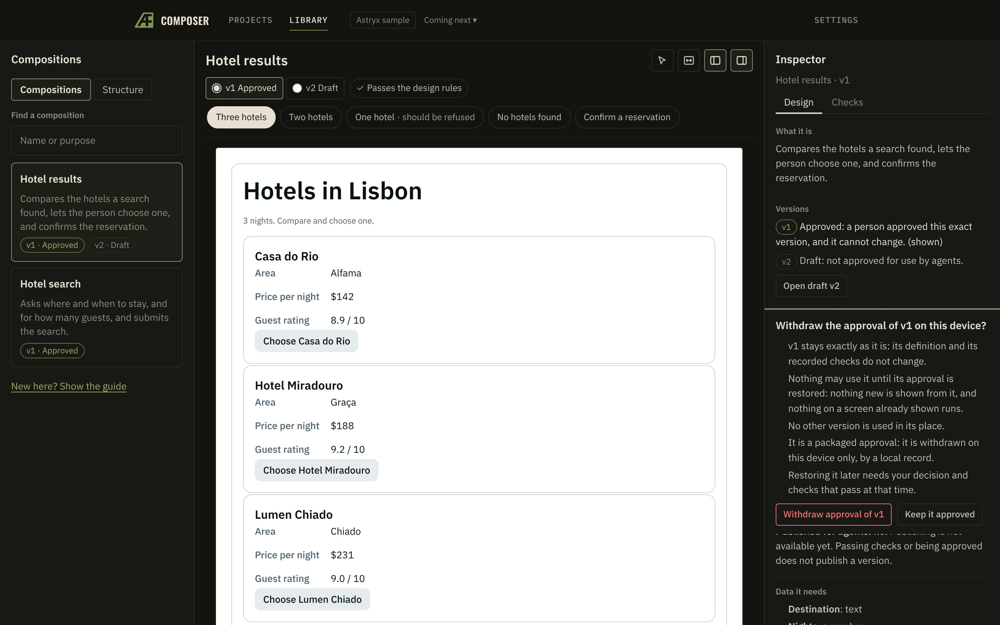
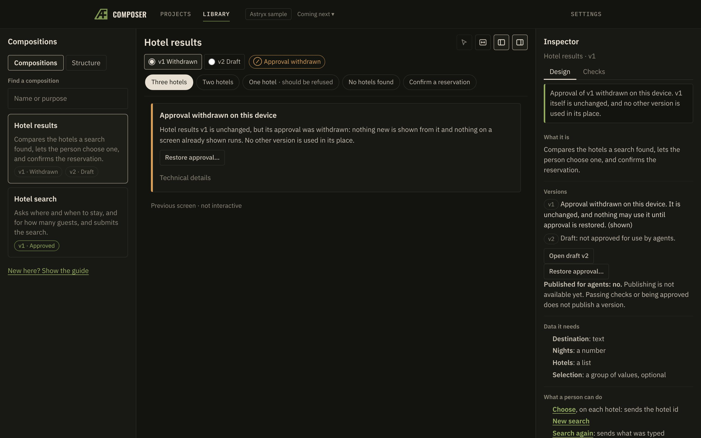
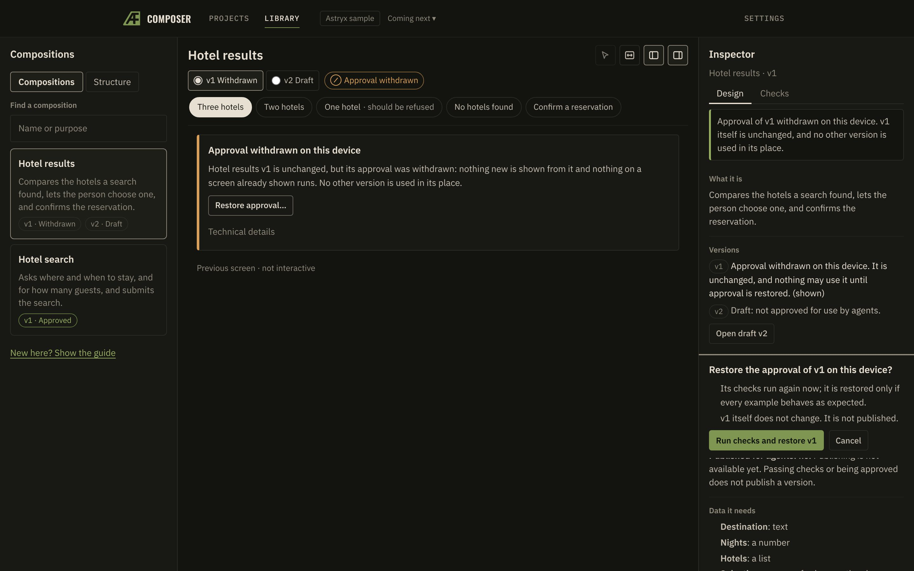
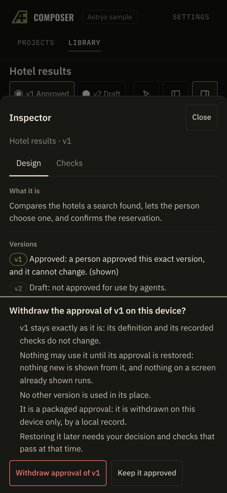
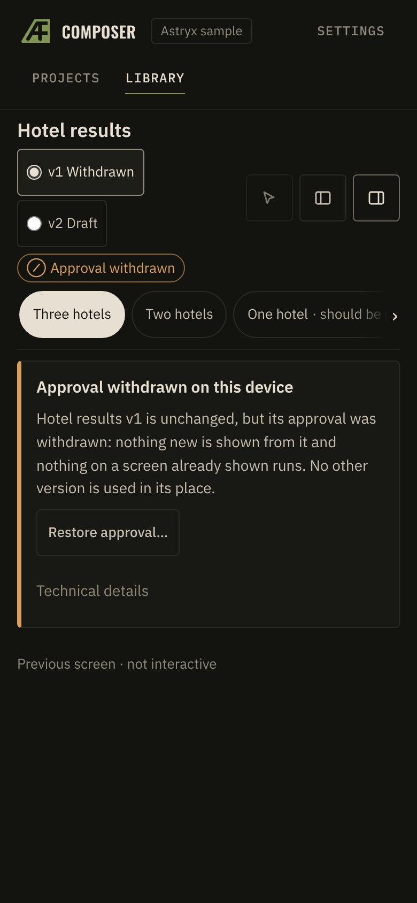

# M1 approval withdrawal on this device (decision 34)

**Status:** implemented for the product owner's evaluation, 2026-11-27. **Not merged or deployed.** Experimental build only; the default application is unchanged.

A person can withdraw the approval of an approved version, and later restore it. Withdrawal is an **authorization-lifecycle decision**: the approved definition stays exactly as it is, and its recorded checks are never rewritten.

## What happens

| | Withdraw | Restore |
|---|---|---|
| **Where** | Inspector, Versions: **Withdraw approval…** on an approved version | **Restore approval…** in the inspector, or on the canvas where the version is refused |
| **Confirmation** | Written out before anything happens: the version stays exactly as it is; nothing may use it until restored; no other version is used in its place; a packaged approval is withdrawn on this device only, by a local record; restoring needs a decision and passing checks | Its checks run again now; it is restored only if every example behaves as expected |
| **Effect** | The host refuses to show anything new from it (`withdrawn`). It also refuses every action on a screen already shown, so existing authorization is invalidated. The last screen is kept for comparison only and is not interactive | The host authorizes it again, with the approval the new check issued |
| **Shown as** | **v1 Withdrawn** in the version control and the list, the pill **Approval withdrawn**, and a canvas panel saying what it means | **v1 Approved** |

## How it is built

- **Core (`host.ts`):**
  - `withdraw(id)` drops the host's authorization;
  - `isWithdrawn(id)` reports it;
  - `restore(id, approval)` is the only way back, and `approve` is refused while a version is withdrawn;
  - `show` refuses with stage `withdrawn` and keeps the current screen;
  - `act` refuses with code `withdrawn` before any other authorization check.
- **Stale authorization:** every approval records when it was issued. A withdrawal records the latest issue at that moment, so an approval issued **before** the withdrawal can never restore it. Neither can a check made against other rules, another composition or another version.
- **Workspace (`withdrawal.ts`, `storage.ts`):** a new validated record, `authorization` (v1), lists withdrawn versions by composition, version, **the exact definition's sha256** and origin (packaged or device). An entry cannot apply to any other definition.
  - **Withdraw** writes the record first. If it cannot be written, nothing is withdrawn and the reason is given, so the interface and the host never disagree.
  - **Restore** checks first, then removes the record, then restores the host. If the host refuses, the record is written back.
  - **On load,** the record is applied to each version's host before anything is shown.
- **Packaged and local approvals stay distinct:**
  - a packaged approval is withdrawn by the local record alone; the packaged definition is never copied or changed;
  - a version approved on this device keeps its own record in `versions`, unchanged;
  - the check evidence (`approvals`) is untouched by both.
- **Withdrawal is not supersession:**
  - approving a newer version withdraws nothing;
  - withdrawing a version authorizes no other;
  - opening a composition whose latest approved version is withdrawn selects that version, withdrawn, not an earlier one.

## Guarantees and how they are held

| Guarantee | Held by |
|---|---|
| A withdrawn version gets no new authorized use, and nothing on its current screen runs | `withdrawal.test.ts` (core): show refused, act refused, definition byte-identical |
| Restoring needs a check issued after the withdrawal, under current rules, for that exact composition and version | Core tests: approve refused, a stale check refused, another composition's check refused, a fresh check accepted |
| No substitute | Core: another version's host is unaffected and nothing is authorized in its place. Browser: after withdrawing v2, reopening selects v2 withdrawn, while v1 keeps its own approval |
| Persists across reload; applies only to the exact definition | `withdrawal.test.ts` (workspace): reload re-applies it; a different definition under the same key is not withdrawn |
| A failed write never leaves state inconsistent | Workspace tests for withdrawing and for restoring with storage refusing writes |
| Definitions and check evidence are not rewritten | Workspace and browser tests compare them before and after |
| Another tab follows a withdrawal | Browser: a withdrawal in one tab refuses the version in the other at once (a `storage` event) |
| Accessible | axe (WCAG 2.2 AA) on the confirmation and the withdrawn state at 1280 and 390 px, with no exceptions. Focus starts on “Keep it approved” |

## Limitations (device-local architecture)

- **Restoration in another tab** is not applied to an open tab: that tab keeps refusing until it reloads, then re-checks. This is the safe direction.
- **This device only.** Another device or browser has its own storage and is not affected. Nothing is published or consumed externally yet, so there is no external authorization to withdraw.
- **Commitments already open.** A consequential action accepted before a withdrawal keeps its idempotency key and can still be settled. Withdrawal stops new acceptances, not reporting the outcome of one already made.

## Screenshots

| | |
|---|---|
|  |  |
| The confirmation, written out | Withdrawn: refused on the canvas, labelled in the version control and the list |
|  |  |
| Restoring runs the checks first | On a phone (390 px) |
|  | |
| Withdrawn, on a phone | |

## Try it

From a clone of dspack-studio:

```bash
pnpm --filter composer build:experimental
```

```bash
COMPOSER_OUT_DIR=out-experimental PORT=3315 node e2e/serve-composer.mjs
```

Then, in **Library** at http://localhost:3315:
1. Choose **Hotel results** and select **v1 Approved**. Open the Inspector and choose **Withdraw approval…**, then confirm.
2. Change the example: nothing is shown from v1, and the draft is not used instead. Reload: it stays withdrawn.
3. Choose **Restore approval…** and confirm. The checks run, and v1 shows again.
